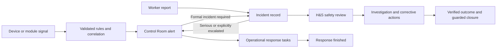

# Health and Safety experience specification

**7 October 2026 · Proposed product specification · Oblivion Findings**

**Direction selected:** the user has chosen option 3 and confirmed that incident ownership can change. The detailed [delivery plan](DELIVERY-PLAN.md) and [ownership contract](OWNERSHIP.md) extend this specification. One named owner at a time is the recommended model; reassignment is explicit and recorded.

**Default recipient selected:** the responsible site manager/coordinator, with a monitored Needs an owner queue if no eligible person is available. Specialist restrictions and declared conflicts take precedence. [Market research](MARKET-RESEARCH.md) adds variable-sensitive requirements. The user's linked Security & Devices request adds [cross-device incident reconstruction](INCIDENT-RECONSTRUCTION.md).

The user has confirmed Oblivion is still in development, with nothing in production. Build and verify the shared synthetic pilot first. Operational/provider/hardware and production-readiness gates below are future requirements, not claims of current production exposure.

Every incident should have its own permanent page. The best fit is a **linked safety case workspace**: the familiar ownership, next action, evidence and history of an IT ticket, adapted to supported living and built on the existing incident, Control Room and H&S records. A worker reports once; each responsible team continues the same connected journey. Short forms remain dialogs, while reading, reviewing and managing ongoing work happens on pages.

Reduce the administrator's Health & Safety sidebar from **21 entries to six destinations**. Preserve every existing capability through meaningful page sections, contextual links and direct addresses. Frontline workers continue to start from **My Day**, the person or their shift.

This is the requested specification and audit, not an implementation or release sign-off. It concerns one operating organisation across approved sites. Roles, permissions, record ownership and privacy remain the authorization boundary. No tenant system or new universal case database is proposed.

**Delivery clarification:** the full agreed scope must work end to end and follow Rory's current design rules. The user requires one complete final release of the shared programme; implementation/test stages are internal checkpoints. The Devices [target scope](../security-devices-audit-2026-10-07/TARGET-SCOPE.md) and [Rory mapping](../security-devices-audit-2026-10-07/RORY-CONFORMANCE.md) align its responsibilities with this specification. Unresolved in-scope hardware/provider capabilities remain release dependencies, not permission to deliver an incomplete programme.

Read with [findings and evidence](AUDIT.md), [cross-module contracts](INTEGRATIONS.md) and [delivery and acceptance](IMPLEMENTATION-AND-ACCEPTANCE.md).

## 1. Five possible approaches

1. **Keep the registers and improve the modals.** Group the navigation, shorten forms and restyle the headers. Lowest disruption, but extended reading, investigation, parallel work and returning to a record remain awkward. Useful as a temporary repair, insufficient as the destination.
2. **Give each incident a conventional ticket page.** Add a stable page with an owner, priority, progress, notes and attachments. A major improvement and a good first delivery. On its own, it leaves H&S events, Control Room, safeguarding and corrective actions looking like unrelated systems.
3. **Linked safety case workspace — recommended.** Give incidents a permanent page and show authorized operational response, H&S review, actions and supporting records together. Keep each domain's actual record and decision authority. Extend the same body pattern to H&S reviews, corrective actions and suitable safeguarding/injury records. This provides the simplicity of option 2 while resolving the cross-module fragmentation.
4. **Person and house centred safety.** Make person and house profiles the main entry points. Excellent for staff providing support and for continuity of care, but weaker for site-wide hazards, staff injuries, impartial investigation and organisation-wide assurance. Adopt these contextual entry points within option 3.
5. **Control Room centred operations.** Route all safety work through one operational desk. Good for urgent response, but would burden routine reporting and make long-term learning depend on operator workflows. Keep Control Room independent and use it when operational response is required.

Option 3 is the strongest fit because supported living crosses people, houses, staff, medication, transport and overnight response. It gives one coherent experience without turning clinical care, safeguarding or regulatory decisions into generic ticket status changes.

## 2. What the product must make obvious

Within the first screen of a record, an authorized user should understand:

- What happened, when and where; who was affected; and what remains uncertain.
- Whether immediate support or protective action is still required.
- Who owns the current response and who owns the review.
- The next action, its due time and any blocker.
- Which linked records are authoritative and how to return after opening one.

Do not require staff to understand `ClientIncident`, `HsEvent` or signal-processing terminology. Display “Incident report”, “Live response”, “Safety review” and “Corrective action” where those distinctions matter.

Do not flatten them into one editable status. “Response finished”, “Report reviewed”, “Action completed”, “Action verified” and “Case closed” mean different things.

## 3. Navigation and full capability preservation

### Six sidebar destinations

| Destination | Purpose | Page sections |
| --- | --- | --- |
| Overview | What needs attention across permitted houses | My responsibility, site attention, current controls and review queues; role-aware content |
| Incidents & concerns | Report and find what happened | Incidents, Safeguarding, Fleet incidents; near misses are an incident view/filter |
| Actions & reviews | Complete, investigate and verify work | Actions, Safety reviews, Investigations; investigation is a view of existing review records |
| Risks & prevention | Prevent recurrence and prepare | Hazards, Risk assessments, Procedures, Emergency drills |
| Safety registers | Specialist operational records | People safety, Equipment & substances, Participation, with the limited sub-tabs below |
| Reports & assurance | Trends, notifications and assurance | Trends, Notifications, Board assurance; contextual links to Compliance and Privacy |

Use the existing route as the landing where practical. The proposed new hub routes, where needed, are `/health-safety/registers` and `/health-safety/reports`; these are proposals, not existing endpoints. `/health-safety/events` remains an addressable Safety reviews view. `/incidents` remains the incident register and `/incidents/{id}` becomes a real record page.

Safety registers uses at most two navigation tiers. People safety contains Lone worker safety, Injuries & recovery, First aid and Restraint & behaviour support. Equipment & substances contains PPE & equipment and Chemicals. Participation contains Representatives, Committees/meetings and Consultations. A user opens the relevant group, rather than facing eleven simultaneous tabs. Unknown or restricted groups are not rendered.

Lone-worker emergencies remain visible on the Overview, My Day and Control Room independently of where the register lives. Safeguarding remains a clearly labelled Report choice and an immediate section under Incidents & concerns; reduction of navigation must not conceal a sensitive reporting path.

### Exact mapping of the current 21 entries

| Current entry | Proposed home | Functionality retained |
| --- | --- | --- |
| H&S Dashboard | Overview | Role/site views, action worklists, reporting launcher, metrics, exports |
| Incidents | Incidents & concerns → Incidents | Capture, drafts, review, follow-ups, attachments, closure/reopen, templates |
| Near Misses | Incidents → Near misses view | Actual versus potential harm and all existing near-miss fields |
| Fleet Incidents | Incidents & concerns → Fleet incidents | Fleet-owned capture, claims/police details, vehicle response, evidence and follow-ups |
| Safeguarding | Incidents & concerns → Safeguarding | Restricted concern, risk, investigation, action-plan and external-report workflows |
| Events | Actions & reviews → Safety reviews | All source categories, H&S acceptance, WorkSafe decisions, investigations and guarded closure |
| Corrective Actions | Actions & reviews → Actions | Ownership, due dates, transfer, evidence, completion, independent verification, return and closure |
| Analytics | Reports & assurance → Trends | Existing charts, filters, drill-downs, denominators and exports |
| Hazards | Risks & prevention → Hazards | Site/person context, controls, risk, inspections, evidence and links |
| Worker Participation | Safety registers → Participation | Representatives, committees, meetings, minutes, consultations and documents |
| Lone Worker Safety | Safety registers → People safety → Lone worker safety | Sessions, check-ins, panic, monitoring, permitted location, alerts and reports |
| Emergency Drills | Risks & prevention → Emergency drills | Plan, start, participants, completion, findings, actions, evidence and cancel |
| Chemical Register | Safety registers → Equipment & substances → Chemicals | Register, SDS, locations, exposure records and status |
| PPE & Equipment | Safety registers → Equipment & substances → PPE & equipment | Types, inventory, allocation, acknowledgement, inspection, return, condemnation/disposal and evidence |
| First Aid Register | Safety registers → People safety → First aid | Care record, follow-ups, equipment/site context, linked incident and evidence |
| Restraints & Behaviour Support | Safety registers → People safety → Restraint & behaviour support | Existing event, review, debrief, plan links, evidence and oversight |
| Workplace Injuries | Safety registers → People safety → Injuries & recovery | Injury, treatment, capacity assessments, RTW plans, modified duties and evidence |
| Safe Work Procedures | Risks & prevention → Procedures | Versions, approval, acknowledgment, attachments and applicability |
| Compliance | Reports & assurance → related Compliance workspace | Canonical obligations and notifiable records remain in their current owning module |
| Risks | Risks & prevention → Risk assessments | Create/edit, activate, review, residual assessment, supersede, archive and evidence |
| Privacy | Reports & assurance → related Privacy workspace | Privacy-owned breach assessment, response, notifications and permissions |

Old bookmarks, notifications, task URLs and query deep links must continue to work. No route is removed merely because its sidebar item is removed. Navigation visibility must use the same capability as the destination, including specialized `procedures.view` and `restraints.view` permissions. A `compliance.view` permission must not expose a link to a `hazards.view`-only page unless an explicit, separately scoped projection is supplied.

The six destinations are a maximum for the ordinary H&S management shell, not six mandatory links for every role. A worker who only reports incidents must not receive an empty H&S administration shell.

## 4. Incident register specification

### Header and filters

Use `PageHeader`, with a Home-rooted breadcrumb, title “Incidents”, a short scope line, scoped search and one primary “Report incident” action. The Report menu also exposes Near miss, Safeguarding concern, Staff injury, Fleet incident and Hazard when authorized, routing to the appropriate existing capture flow.

Use 4–6 linked meters: Needs review, Active response, Open follow-ups, Review overdue and Reported in period. Show the time basis on each meter. “Open now” and “Reported in selected period” cannot share a misleading single period label. Every meter opens its exact filtered view and count.

Filter by site, person, incident type, report state, response state, owner and occurred-date range. Keep a small primary view set: Needs attention, All incidents, Near misses and Closed. Follow-ups and overdue reviews are saved filters linked from meters and Actions & reviews. Keep old `tab=` values working. Whether an initial user preference defaults to Needs attention must be explicit; do not silently apply “30 days” to a label while showing all records.

### Readable rows

Use the shared `EntityTable` and `EntityCard` patterns as appropriate to the existing surface. The meaningful incident title and reference are the primary link. Preserve the full description on the record page; show a short factual summary in the list, with no requirement to hover to obtain critical information.

Desktop columns: Incident, Person/site, Occurred, Harm/severity, Current work, Owner/next due, Actions. “Current work” uses human labels such as Awaiting report review, Live response active or Awaiting verification. Do not show a large collection of unexplained icon flags.

Provide an actual keyboard-focusable link for every record and a visible kebab using the same permitted actions as the right-click menu. Click opens the dedicated page; an explicitly labelled Quick view may show a short read-only preview. Quick view is optional and must not become the only way to work.

The back link restores filters, search, page number and scroll position. Open in new tab, copy link, browser Back and refresh must all work. Search includes the canonical reference as well as title and allowed content. A source's restricted narrative must never be indexed into another role's search results.

## 5. Permanent incident workspace

### Page address and identity

`/incidents/{incident}` is the permanent page. The normal render contains no automatically open modal. The document title contains the real reference and a concise title. Old `/incidents?incident={id}` links resolve to the same record while retaining a safe register return context.

Use the approved work-record body pattern from `design_styles/WORK_RECORD_STYLE_GUIDE.md`. The header identifies the incident; the body carries the work. Do not clone IT ticket business rules, conversation visibility, SLA defaults, merge rules or universal ticket statuses.

Header facts: incident reference, short title, reported state, occurred time in New Zealand time, person/site if permitted, and relevant sensitivity restriction. Meter links reveal open actions, review state, response state and evidence. Never fabricate metrics merely to fill header slots; use meaningful record facts accepted by the PageHeader contract.

### Sections

1. **Overview.** What happened; immediate actions actually taken; current support/control needs; actual harm and potential harm separately; affected person/site/source; concise latest update. Include the person's account, preferences and communication/support needs where recorded and appropriate. Missing facts say “Not recorded” or “Needs checking”.
2. **Response.** Authorized live response summary, accountable operator, protective tasks, escalation, relevant playbook state, last confirmed contact and next checkpoint. Link to the canonical Control Room alert. No alert is a legitimate state: “No live response requested”, not “Response completed”.
3. **Review.** Report review and linked H&S review; acceptance owner; proportionate investigation; notification decisions; closure readiness. Use meaningful sub-tabs only when needed: Review, Notifications, Closure. Show unknown/pending decisions distinctly.
4. **Actions.** Incident follow-ups, operational response tasks and corrective actions, labelled by their purpose and owner. Preserve their canonical IDs and transitions. A user must see which action will prevent closure and which authorized person can complete it.
5. **Evidence.** Attachments and authorized linked evidence grouped by source, with title, uploader, time, version and access. Preview through the approved file-preview component. Do not copy files from medication, safeguarding or Control Room merely to show them together.
6. **History.** Attributable chronological activity with occurred versus recorded time, status decisions, amendments, ownership changes, notifications and source links. Compact notes are collapsible with an accurate count and Add note/Continue note. Important restrictions remain outside collapsed notes.

At wide desktop widths, use approximately two thirds for narrative/detail and one third for the action panel, adjusted to actual component constraints. At a narrower desktop window, stack in the same reading order. This is a content hierarchy, not permission to introduce a new UI framework.

### Persistent action panel

The panel shows the next permitted action, responsible person/team, due date and blockers. Examples: Submit report, Review report, Accept safety review, Complete follow-up, Verify corrective action, Review notification decision. Do not render an enabled action whose server path will predictably deny this role.

Urgent outstanding response remains prominent under the approved priority policy even when this viewer's own next task is a routine review. Show only authorized scope/owner context and a safe escalation route. “No action available to you” must never mean “Journey complete”; derive completion from the actual source gates.

Use distinct ownership labels: Reported by; **Incident owner**; Response owner; Review owner; Lead investigator; Action owner. The incident owner coordinates the connected work and can be reassigned by an authorized person with a reason and preserved history. Giving someone a follow-up or investigation does not automatically transfer the whole incident. Selecting a review owner does not imply that they accepted a required handover. Distinguish “Assigned to” from “Accepted by” and record both timestamps where the domain requires them. Ordinary incident ownership follows its explicit assignment contract, not an invented acceptance requirement.

Show the same incident owner in the register, page, All Tasks and permitted source summaries. Provide Assign/Reassign, Owned by me, Needs an owner and Owner needs replacement where appropriate. A missing owner never blocks a worker from reporting or prevents an urgent operational response. Assignment does not grant restricted source access. The existing legacy investigator field is not the new incident-owner field; see [OWNERSHIP.md](OWNERSHIP.md) for routing, eligibility, transfer, absence, migration and acceptance requirements.

Explain blocked closure with a checklist and direct links to each unmet requirement. Keep typed closure reasoning when a prerequisite is missing. Any terminal menu action must call the same guarded server transition as the main close button.

### Reporting and edits

Keep `WizardShell` for multi-section report capture and entity edits, with Review and a real submission receipt. Short one-step actions use the approved simple dialog. Do not nest large workflow dialogs inside large detail dialogs.

Capture flow: Type and context → What happened → Immediate response and harm → Follow-up/contacts where relevant → Review. Staff should not be forced to answer governance questions they are not qualified to decide. “Unsure” routes to review rather than silently becoming “No”. Conditional questions preserve hidden prior answers safely and only submit applicable values.

Reuse current request UUID and server draft recovery. “Saved draft”, “Submitted” and “Could not save” must be truthful. A failed submission preserves input and evidence selections. A duplicate retry returns the same incident. Drafts are private to authorized authors; they must not appear as completed reports in governance counts.

Person/shift/site context from My Day or a person profile is prefilled and revalidated on the server. The generic client-incident endpoint currently requires a client. Staff injury, hazard, equipment-only or unknown-person reports must use the appropriate typed intake path; never select a random person merely to make the form save. Supporting genuinely unknown-person client incidents would require a separately designed schema/authorization extension, not removal of validation alone.

Submitted records retain their original facts and history. Authorized corrections capture reason, author and timestamp; the specification does not authorize silently rewriting clinical or safeguarding source records.

## 6. Safety review and action pages

`/health-safety/events/{id}` becomes a permanent **Safety review** page with the source reference visible. A source-backed incident page and a specialist safety-review page present the same H&S record, not independent copies of its investigation. A hazard or staff injury can have a review without a client incident.

Keep the event's source category, occurrence/site scope, handover acceptance, WorkSafe decision provenance, investigation findings, recommendation dispositions, residual risk and existing closure exceptions. A routine near miss must be reviewable proportionately without creating an unnecessary full investigation. The existing determination of whether an investigation is required remains authoritative until an approved policy change.

Create an addressable corrective-action page under the existing H&S family, with a proposed route `/health-safety/corrective-actions/{id}`. It shows the source finding, accountable owner, actual executor if different, due date, completion evidence and independent verification. Parent event links must land on the relevant section.

Preserve `open → in_progress → completed → verified → closed`, including authorized return-for-rework. Completion does not prove effectiveness. A verifier must satisfy the existing separation-of-duties rules; verification names the evidence and outcome. An action transferred from Control Room has a visible transfer receipt and a single receiving responsibility.

Current corrective-action owner eligibility requires H&S management authority. Do not solve ordinary worker execution by giving everyone `hazards.manage`. First support completion of the linked domain task (for example Maintenance). Where worker execution is needed directly, introduce a narrowly authorized participant action and separate it from the accountable H&S owner, with record/site checks and explicit acceptance tests.

## 7. Control Room and incoming work

### How it currently works

A signal is an observation or integration event. Rules may suppress it, correlate it to an existing alert, route it to another domain, or create an alert. An alert is work requiring operational attention; it is not automatically proof of harm. The desk and active-alert views show operational work. The current Safety handovers view follows formal incident/H&S continuation.

A submitted client incident gets its canonical H&S event through `IncidentJourneyService`. High/critical-equivalent incidents can receive an automatic alert; explicit escalation can request one at other severities. An alert-created incident reuses the linked journey under locks. Separate source adapters exist for fleet, hazards, first aid, restraint, injury and other safety records.

Two handovers must remain distinct: transferring a safety review to H&S, and an outgoing Control Room shift being accepted by its incoming lead. Staffing a planned operator shift is not accepting responsibility for a live response.

### Required behavior

Use **Incoming** as a clear view of new/unacknowledged operational alerts, if that label is adopted; it is not a second signal store or a second incident register. In the inspected hosted build, the labels are Desk, Active alerts, Escalations and Safety handovers rather than a distinct Incoming page.

Support internal, external or combined response arrangements, configured by approved site/event/service and coverage. Retain a named internal incident coordinator. External dispatch, receipt, acceptance and safe outcome differ; delay/failure has an explicit internal/on-call fallback. Provider connectivity and restricted data access require their own supported contract, first exercised with development simulators.

The operator sequence is:

1. See why the item needs attention, source freshness, site/person scope and immediate urgency.
2. Acknowledge receipt and claim/assign a response owner; these are distinguishable actions.
3. Triage with a recorded outcome: continue response, false/unsubstantiated alert, technical fault, existing incident, new incident, specialist safeguarding path, or further assessment required.
4. Link or create the appropriate formal record when indicated. Display an existing match before offering a duplicate creation action. Group related alerts only when provenance and scope support it.
5. Complete or explicitly transfer operational tasks. Transfer records sender, receiver, reason and acceptance where required; it does not fabricate completion.
6. Resolve the operational response when its own gates pass. Show “Response finished; safety review still open” when true.
7. Hand over open operational work to the incoming shift through the existing reviewed snapshot and acceptance flow. A prepared handover leaves the outgoing shift responsible until accepted.

Replace “every active alert without a client incident needs one” with a **recording decision** that recognizes incident, safeguarding, fleet, injury, technical work, no formal incident required, and undecided. Undecided remains visible for triage. A no-incident decision requires an authorized actor, reason, time and evidence; it must not override a domain rule that requires a report.

Emergency precedence must be a documented clinical/operational policy implemented identically in database ordering and compact views. Proposed order: immediate danger/critical response first; then other uncontained high-priority risks; then current missed response deadlines; then due time and age within the group. Preserve historical SLA breaches as history without automatically presenting every old breach as current critical harm. Require the service owner to approve severity/priority mapping before activation.

Expose source failures: Not received, Awaiting processing, Delivered to response, Suppressed by named rule, Failed delivery and Retrying. An empty incoming list does not prove every person or device is safe. Show actual coverage and last successful signal separately.

Before relying on sensor response, jointly repair the source-confirmed fall classification/canonical-device context and blanket maintenance-suppression issues described in [the reconstruction response](INCIDENT-RECONSTRUCTION.md). Critical severity is currently retained; the defect must not be described as a severity downgrade. Technical maintenance and deliberate life-safety testing need distinct, approved behavior.

### Reconstructing an occurrence

The Evidence section provides a bounded time-window timeline from relevant sensors, camera/recording references, door events, permitted vehicle/staff/person tracking and response history. Devices owns source observations, historical assignments and provider access; Control Room owns live response; incident/H&S owns its investigation and review. Extend the existing sensor-to-incident bridge and shared evidence primitives; do not turn care incidents into IT tickets or duplicate source data across screens.

Preserve occurrence versus receipt time, UTC provenance, NZ display, known clock skew, historical assignment and inclusion reason. Missing/offline/stale sources and incomplete collection are visible. Observations, human interpretations and inferred associations remain distinct; do not infer cause, identity or exact sequence from proximity alone. An expanded evidence window is justified and versioned.

Make the pre/post-event evidence window configurable within Oblivion by authorized users, with approved scope/source types, trigger, maximum and override reason. Record the applied rule/version and actual coverage on each set. A settings change cannot silently expand a historical collection or bypass source privacy. Pilot window values are synthetic examples, not fixed organisational policy.

Live CCTV appears inside Oblivion only through a supported authorized provider session and is labelled Live now. Recordings may open the vendor at the relevant time where supported. Show actual availability/expiry, preservation request versus confirmation, retained export and failure. A link or metadata hash is not proof footage was preserved. Current source permissions apply to view, live access, export and download even where historical context differs. See R01–R10 in the shared contract.

Make action permissions and approved source scope configurable: live viewing, recorded playback, audio/talkback, snapshots, preservation/export, staff current/history location and supported-person location are separate grants. Provide an effective-access preview and audited/versioned changes. Role templates must remain constrained by source authority, purpose, consent where applicable and expiry. An investigator or IT role does not automatically confer access to every camera or location history.

For access-reader evidence connected to attendance, recommend assisted timekeeping: trusted events suggest times, My Day lets the worker confirm/correct, and dedicated HR Attendance owns approved time and payroll effects. Also support configured manual/app and designated automatic-reader modes. All modes preserve source evidence, exceptions and HR approval/correction rules; generic door events or location alone do not prove paid work. H&S consumes authorised evidence without becoming the timekeeping authority. Separate organisation installations may configure different equipment/providers while preserving the single-organisation architecture.

## 8. Preserve independent lifecycles

| Record | Authoritative lifecycle or decision | Required presentation |
| --- | --- | --- |
| Incident | draft, submitted, reviewed, closed; controlled reopen | Draft, Awaiting review, Reviewed, Report closed |
| Control Room alert | open, ack, triaging, confirmed, resolved, closed, dismissed | New, Acknowledged, Assessing, Response active, Response finished, Closed, Dismissed; preserve real transitions |
| H&S event | open, investigating, corrective_action, monitoring, closed | Needs review, Investigating, Actions underway, Monitoring, Review closed |
| H&S acceptance | not_ready, awaiting_acceptance, accepted, not_required | Not ready, Awaiting acceptance, Accepted, Acceptance not required |
| Corrective action | open, in_progress, completed, verified, closed | Open, In progress, Awaiting verification, Verified, Closed |
| Notification | decision and delivery evidence, separately per destination | Needs decision, Not required with reason, Required, Prepared, Sent/recorded, Receipt recorded, Failed |

The proposed notification display vocabulary must map to each owning module's actual fields; it is not permission to mass-rename enums.

Compute the overall journey summary from the required branches and their real states. A missing expected link is “Link needs repair”, not “Complete”. An optional absent branch is “Not required/not requested” with the appropriate decision context. Do not let a generic dropdown change all records.

Keep current hard closure gates, signed WorkSafe decisions and controlled exceptions. The current H&S service also requires notification, acknowledgement and site-preservation handling when applicable. Present these as existing application requirements; do not claim every application gate is itself a statutory requirement. Any change to that policy needs an explicit policy decision and fresh regression evidence.

Reopening preserves previous findings and closure receipts. It must explain which branch reopened and which related work now requires rechecking. Closed incident reports, verified actions and a released vehicle are not all automatically reopened or invalidated by one note.

Keep response, ownership/triage, report-review, action and external-notification deadlines separate. Reassessment of severity/category is versioned and shows affected obligations; it never resets elapsed time or overwrites a signed decision. Waiting for external information has a named reason and review point, not a blanket pause of every clock. Reuse approved response/investigation templates with provenance and duplicate-safe confirmation.

## 9. Supported living requirements

The workflow must support community houses, respite and individual support, with role-specific terminology rather than a hospital-only model.

- **Person's voice and recovery.** Record the person's own account where possible, what they want to happen next, accessible communication, advocacy/support offered and relevant cultural preferences. Separate a factual observation from a hypothesis. Avoid blame-oriented or deficit-only titles.
- **Whānau and representatives.** Record who should be involved according to the person's wishes and lawful authority, who was actually contacted, when and the outcome. A family relationship does not automatically authorize every disclosure. Do not broadcast safeguarding allegations through ordinary handover or push notifications.
- **Proportionate learning.** Support a simple review for lower-complexity events and fuller multidisciplinary review where indicated. Record contributing systems, environmental factors and what would reduce recurrence; do not force unsupported “root cause” certainty.
- **Behaviour support and restraint.** Link the approved support plan, alternatives attempted, required authorization/review, monitoring and debrief. Keep PRN medication, restrictive practice and safeguarding decisions distinct. Medication administration is not automatically restraint, nor does a generic incident close authorize it.
- **After-hours continuity.** Make on-call contact, current response owner, last confirmed contact and next safety check discoverable. Show a failed/unaccepted handover as outstanding work.
- **Staff support.** Keep staff injury and recovery private. Share only authorized work-capacity restrictions with scheduling. Offer debrief/support follow-up without labelling staff medically from incident data.
- **Preventive follow-through.** An incident can produce a linked hazard, maintenance job, plan review, procedure change or training action. H&S verifies the outcome; the source module owns its execution.

These priorities align with the person/whānau-centred direction of [Ngā Paerewa](https://www.health.govt.nz/regulation-legislation/certification-of-health-care-services/services-standard) and the learning focus of the [national harm policy](https://www.hqsc.govt.nz/our-work/system-safety/healing-learning-and-improving-from-harm/). Applicability depends on the provider's actual services, certification and contracts.

## 10. Notifications and regulatory assurance

WorkSafe is one reporting track. The product must not present its decision as a complete answer for disability-service notifications.

The current [DSS guidance](https://www.disabilitysupport.govt.nz/providers/reporting-of-critical-incidents-and-deaths), updated 2 October 2026, distinguishes contractual critical-incident reporting within 24 hours, death notification to NASC/EGL/FCS within 48 hours, and additional residential-service death-review requirements. It also distinguishes DSS reporting from qualifying Te Tāhū Hauora reporting. Configure applicability and approved rules for the organisation's service contracts; do not apply every deadline to every event.

For each relevant destination, record applicability, decision-maker, rationale, rule/version, due time, responsible owner, prepared content, submission method/reference and receipt. “Exported” is not “Sent”; a stored manual notification is not an API delivery. Future automated transmission requires a supported connection and explicit sending authority. This audit sends nothing externally.

WorkSafe decisions remain accountable human decisions with evidence and source provenance. The [WorkSafe notification guidance](https://www.worksafe.govt.nz/notifications/what-events-need-to-be-notified/) and [HSWA record requirement](https://www.legislation.govt.nz/act/public/2015/70/en/latest/sections/DLM6544145/) support keeping notification and preservation obligations distinct. Retention must be record-specific, preserve legal holds and not reduce clinical/privacy requirements to one generic five-year cleanup rule.

Privacy breach decisions belong to the existing Privacy workflow. Health information access/disclosure must account for the current [Health Information Privacy Code](https://www.privacy.org.nz/privacy-principles/codes-of-practice/hipc2020/). A safety-case link is not authorization to expose a restricted source.

## 11. Rory design conformance

The current authority is `DESIGN.md` and the current `design_styles/` guides. Do not edit those files or create a competing H&S design standard.

- Use one `PageHeader`: identity/action row, one linked meter row, filters inside the header and the connected primary rail on its bottom edge. Include Home (`/dashboard`) in breadcrumbs. Do not preserve the old H&S `HeroShell` as the new design merely because it uses some shared buttons.
- Use the branding ramp and semantic tokens supplied by the component. Safety warning colors remain fixed and brand-independent. No decorative green “live” marker without an actual live/freshness state.
- Replace the extra workflow ribbon and separately boxed tab strip with meaningful connected navigation. Secondary tabs sit directly on the page background, using the shared positional tones and current pixel dimensions. No pinned sub-tabs.
- Use `EntityTable`, cells, menus and list captions. Row link, keyboard behavior, kebab and right-click menu must all work. Preserve existing action parity.
- Use `StatusBadge`/shared vocabulary and icon plus text. Distinguish report state, harm/severity, due state and freshness; they are different concepts.
- Use the shared New Zealand date/time helpers for visible text, tooltips, date filters and exports. Handle date-only values separately from instants. Test near-midnight and daylight-saving boundaries.
- Use `WizardShell` for multi-section create/edit and shared simple dialogs for short actions. Keep unsaved-change confirmation, Review/Back preservation, server validation, success receipts and retry. Use the existing file-preview and searchable-selector patterns.
- Preserve compact desktop geometry. Support 1440×900 and 1280×800, keyboard-only navigation and 200% zoom. Existing frontline surfaces retain their accessibility/hit-target requirements; do not redesign eMAR's desktop scope or add a second worker shell.

### Banner truthfulness

Replace “Safety system · synced just now” with an actual refreshed time or omit it. “No active sessions” must not become “All workers checked in”. No alert is not evidence of legal compliance. Replace blanket “HSWA duty met”, “ACC ready” and zero-count “current” claims with measured coverage, unknown/stale states and links to supporting evidence.

Urgent banners contain a concrete risk, the affected scope, the action and the accountable route. Routine statistics belong in meters or sections. Do not stack multiple competing banners above the actual work.

## 12. Overview and reports

Overview starts with actionable work: urgent/unowned responses, awaiting acceptance, overdue review and verification. Follow with controls/prevention due and a concise trend summary. Do not lead ordinary managers with LTIFR/TRIFR jargon. Preserve those measures in Reports with definitions and valid hours denominators.

“Site safety league” becomes a neutral site comparison with context. Low reporting volume must not be presented as proof of a safer house. Report counts, actual harm, exposure/denominator, follow-through and data completeness separately. Near misses can reflect a healthy reporting culture.

Recommended measures: response acknowledgement and first action; report review time; acceptance delays; corrective-action timeliness and effectiveness; repeat-event themes; person/whānau follow-up where appropriate; due notification decisions; restraint reduction; monitoring coverage/freshness. Define numerator, denominator, time basis, permitted scope and unavailable state for every measure.

Count a linked incident/alert/review once when measuring the underlying incident. Count their distinct tasks separately only when the metric explicitly measures work items. Every chart and meter must drill through to the same authorized population; exports use the same scope and definitions.

If one occurrence affects several people, retain legitimate person-specific reports and confidential staff branches under the existing originating source where possible. Define occurrence counts separately from person-incident counts. Do not automatically merge similar narratives or different people's accounts; link suspected duplicates and learning themes through reviewed, permission-controlled relationships. Placement change, discharge or death does not itself close outstanding review or reporting work.

Board assurance is a redacted aggregate with authorized drill-through. A board role does not automatically gain identifiable clinical, safeguarding or staff-injury narratives.

## 13. Data and implementation constraints

Reuse existing `ClientIncident`, `HsEvent`, `HsInvestigation`, `HsCorrectiveAction`, alert and source records. Extend the current journey presenter to supply the page with a permission-shaped read model and guarded action descriptors. Do not introduce another case number, replicated timeline or mirrored evidence store.

New fields should be additive and justified by a missing contract, such as recording-decision provenance or source freshness. Before any backfill, classify existing links as valid, absent, conflicting or legacy; ambiguous links require review. Never manufacture acceptance, notification delivery or verification for old records.

Mutation boundaries recheck current user authority, exact parent-child relationships, approved site and record revision. Use existing transactional locks and idempotency identities. Stale pages preserve drafts and explain what changed. Post-commit delivery failures must remain visible and retryable without creating another incident.

Performance: server-side pagination/filtering, bounded relationship loading and shared scoped aggregate definitions. Avoid loading the full investigation/evidence history into every list row or polling thousands of records per page. Keep source timestamps on materialized summaries.

Security applies to lists, counts, search, exports, evidence, notifications and history as well as page access. Every attachment request reauthorizes the source record. Preserve the merged eMAR external-clinician isolation: dedicated external prescriber accounts do not receive internal safety-case access through a new link or shared projection.

## 14. Outcome required before calling this complete

All 21 current destinations have a tested home; each incident opens as a true page; ordinary staff can report and resume without understanding administrative modules; Control Room routes work proportionately and keeps urgent response prominent; evidence and ownership survive handovers; source modules receive understandable outcomes; Rory's current components govern the UI; and the acceptance journeys in the delivery plan pass against an identified candidate.

The aim is a calmer, more complete supported-living safety workflow. “Best in class” is a product ambition to evaluate with workers and managers, not a claim established by this audit.
