# Security & Devices — Delivery Progress

## Phase 0 — Clean-up, honesty, readiness, and simple navigation

### Summary of changes

1. **Test fixture purge command (`0.1`)**
   - Added `php artisan security-devices:purge-test-fixtures` (`--dry-run` / `--force`) in `app/Console/Commands/PurgeSecurityDevicesTestFixtures.php`.
   - Safely removes release acceptance fixture packs, standalone test/demo devices, and test-only Sites inside a database transaction while unlinking immutable `device_relationships` rows and preserving real devices (`UX7`, `Care tracker 867963069916998`, `unif`).
   - Verified `scripts/deploy-server.sh` and `.github/workflows/*` contain **no** deploy step that re-creates Security & Devices test fixtures.

2. **Honest health & monitoring status (`0.2`)**
   - Unmonitored devices now always report `not_monitored` (`Not monitored`) instead of `healthy` across list pages, workspaces, maintenance health summaries, and device profiles unless active check evidence exists.
   - Added `not_monitored` to `resources/js/lib/status-colors.ts` and `resources/js/lib/security-devices-labels.ts`.

3. **Honest CCTV live source status (`0.3`)**
   - Fixed the regression from `80993a992` in `SecurityWorkspacePresenter.php` so Hikvision/CCTV cameras only display `Live source verified` when `stream_state === 'verified'` and `stream_verified_at !== null`. Configured but unverified streams now show `Source configured (not verified)`.

4. **Windows ICMP ping accuracy (`0.4`)**
   - Rewrote `NativeIcmpTransport.php` to require a genuine echo reply line from the target IP address with parsed latency (`time=Xms` / `time<1ms`).
   - Rejects Windows `ping.exe` exit-code-`0` false positives (`Reply from <local-ip>: Destination host unreachable.`, `TTL expired in transit.`, or replies from a router/gateway IP rather than the target).

5. **Hide fake network configuration backup (`0.5`)**
   - Removed `backup_config` from `DeclaredDeviceCommandCapabilities.php` and failed closed in `NetworkDeviceCommandAdapter.php` until real vendor SSH configuration drivers land in Phase 5.

6. **Encrypted database credential store by default (`0.6`)**
   - Changed `MONITORING_CREDENTIAL_DRIVER` default in `config/monitoring.php` from `'unavailable'` to `'database'` (keeping HashiCorp Vault optional via `MONITORING_CREDENTIAL_DRIVER=vault`).
   - Added `monitoring_encrypted_secrets` migration (`2026_10_27_000001_create_monitoring_encrypted_secrets_table.php`), `MonitoringEncryptedSecret`, `EncryptedDatabaseSecretStore`, and `EncryptedDatabaseSecretLeaseIssuer` using `Encrypter` + HMAC-SHA256 reference fingerprints and `sodium_memzero` memory scrubbing.
   - Verified via feature tests that secret values never appear in Inertia responses, application logs, or audit log rows.

7. **Settings › Server readiness (`0.7`)**
   - Added `Settings › Server readiness` (`/settings/server-readiness`) via `ServerReadinessService`, `ServerReadinessController`, `system:scheduler-heartbeat` + `RecordDefaultWorkerHeartbeatJob` (every minute in `routes/console.php`), and `resources/js/pages/settings/server-readiness.tsx`.
   - Evaluates **Redis**, **Scheduler**, **Monitoring workers**, **Endpoint workers**, **Ping permission** (live loopback probe), **Collector keys**, **Release signing key**, and **Credential store**, showing `<StatusBadge>` green/red states with plain-English fix steps.

8. **Simple and easy navigation & plain English (`Item 7` inside Phase 0)**
   - Consolidated Security & Devices sidebar navigation to five entries: **Overview**, **Devices**, **Sites**, **Alerts & upkeep**, and **Setup**, with section tabs (`SecurityDevicesSectionTabs`) on grouped destinations.
   - Unified the **Devices** list (`/security-devices/devices`) with category/type filters and hid empty profile tabs.
   - Added a **First-run setup** checklist card on **Overview** (`/security-devices`).
   - Replaced internal jargon across Security & Devices UI copy (including simplifying `Records & governance` to `History & files`), fixed WCAG AA text contrast on the `DeviceProfileHeader` Event Horizon sky (`text-band-foreground/75`), and enforced `security-devices-copy/no-jargon` in `eslint.config.js` (blocking `canonical`, `governed`, `provenance`, `evidence-backed`, and `projection`).

---

### Live `.com` fixture purge (`0.1` — executed 28 Oct 2026 NZDT)

- **Pre-deploy & pre-purge MySQL backups verified on `oblivionfindings.com` (stored outside `/var/www/oblivionfindings`):**
  - `/home/oblivion/db-backups/oblivionfindings-pre-phase0-20261027T133359Z.sql.gz` (`43 MB`, `0600`, `gzip -t` OK)
  - `/home/oblivion/db-backups/oblivionfindings-pre-fixture-purge-20261027T134455Z.sql.gz` (`43 MB`, `0600`, `gzip -t` OK)
- **Live execution result (`php artisan security-devices:purge-test-fixtures --force` at `254675f68`):**
  - `Purge complete: 1 relationships unlinked, 19 devices hard-deleted, 3 devices soft-deleted (history retained), 5 Sites removed, 2 fixture packs removed.`
  - Post-purge `--dry-run`: `Release fixture packs (0)`, `Test fixture devices to remove (0)`, `Test Sites to remove (0)`, `Real devices preserved (3)` (`1` `UX7`, `2` `Care tracker 867963069916998`, `95` `unif`).
  - `php artisan database:verify-lifecycle-triggers postflight --json` → `"status": "verified"`, `16/16` triggers intact, `0` errors.
  - `git -C /var/www/oblivionfindings status --porcelain` → empty.

#### Release fixture packs removed (2)
| ID | Pack key | State | Manifest records |
| --- | --- | --- | --- |
| 8 | `it-security-desktop-release-v1` | `ready` | 76 |
| 9 | `it-security-desktop-release-v10` | `ready` | 76 |

#### Test fixture devices to remove (22)
| ID | UID | Name | Provider |
| --- | --- | --- | --- |
| 3 | `CCT-BFTN2GEX` | `UI Alignment Test Device` | `—` |
| 74 | `NET-WYWZ4RYS` | `RELEASE Alpha Gateway` | `manual` |
| 75 | `NET-VMEVKDVT` | `RELEASE Alpha Switch` | `manual` |
| 76 | `ACC-FAQFBGIX` | `RELEASE Alpha Door` | `release_fixture` |
| 77 | `ACC-PIUPXJ30` | `RELEASE Alpha Door Secondary` | `release_fixture` |
| 78 | `CCT-K7ABPD3E` | `RELEASE Alpha Camera` | `manual` |
| 79 | `FAL-EYW5NMIL` | `RELEASE Alpha Healthcare` | `manual` |
| 80 | `PER-I5RDFDHZ` | `RELEASE Alpha Personal Tracker` | `manual` |
| 81 | `VEH-8YCBYIES` | `RELEASE Alpha Fleet Tracker` | `manual` |
| 82 | `COL-0IBBBC8B` | `RELEASE Alpha Environment Sensor` | `manual` |
| 83 | `END-GBSAB6F4` | `RELEASE Hidden Device` | `manual` |
| 84 | `NET-XIZM77EC` | `RELEASE V10 Alpha Gateway` | `manual` |
| 85 | `NET-PWIMHRTE` | `RELEASE V10 Alpha Switch` | `manual` |
| 86 | `ACC-CHIGXHEL` | `RELEASE V10 Alpha Door` | `release_fixture` |
| 87 | `ACC-MRFXBJZM` | `RELEASE V10 Alpha Door Secondary` | `release_fixture` |
| 88 | `CCT-ZZQYLDE0` | `RELEASE V10 Alpha Camera` | `manual` |
| 89 | `FAL-MI4IREBL` | `RELEASE V10 Alpha Healthcare` | `manual` |
| 90 | `PER-NOVRY8AB` | `RELEASE V10 Alpha Personal Tracker` | `manual` |
| 91 | `VEH-SLSNLYKI` | `RELEASE V10 Alpha Fleet Tracker` | `manual` |
| 92 | `COL-JZGDXYMW` | `RELEASE V10 Alpha Environment Sensor` | `manual` |
| 93 | `END-VHL8CHRK` | `RELEASE V10 Hidden Device` | `manual` |
| 94 | `DEMO-LOCATION-20260922` | `Demo Location Tracker (simulated)` | `manual` |

#### Test Sites to remove (5)
| ID | Name |
| --- | --- |
| 9416 | `RELEASE Site Alpha` |
| 9417 | `RELEASE Site Hidden` |
| 9422 | `RELEASE V10 Site Alpha` |
| 9423 | `RELEASE V10 Site Hidden` |
| 9424 | `Demo Location Site` |

#### Real devices preserved (3)
| ID | UID | Name | Provider |
| --- | --- | --- | --- |
| 1 | `NET-S9OZVHUU` | `UX7` | `—` |
| 2 | `867963069916998` | `Care tracker 867963069916998` | `queclink` |
| 95 | `NET-QQKSSO9D` | `unif` | `unifi` |

---

### Verification & local walkthrough

- **Laravel Pint:** 0 issues across all 37 touched/new PHP files.
- **TypeScript (`tsc --noEmit`):** 0 errors across the repository.
- **ESLint (`--max-warnings=0`):** 0 errors and 0 warnings across all Security & Devices, Settings, sidebar, e2e, and `eslint.config.js` files (including `security-devices-copy/no-jargon`).
- **Vitest:** 99 test files / 986 tests passed.
- **Pest:**
  - Architecture & Unit (`tests/Architecture`, `tests/Unit/Monitoring`, `tests/Unit/SecurityDevices`): 943 passed (25,236 assertions) in touched scope.
  - Feature (`ServerReadinessTest`, `EncryptedDatabaseCredentialStoreTest`, `PurgeSecurityDevicesTestFixturesTest`, `SecurityWorkspaceTest`, `NetworkDevicePortAndBackupCommandsTest`, `DeviceControllerTest`, `DeviceProfileWorkspaceTest`, `MaintenanceHealthControllerTest`, `DashboardControllerTest`, `SecurityDevicesNavigationRoutesTest`, etc.): 236 passed (>3,100 assertions).
- **Home network Windows ICMP check (`172.16.0.0/24`):**
  - `127.0.0.1` → `reachable: true`, `latencyMs: 0`, `reasonCode: "reply"`
  - `172.16.0.93` (local PC) → `reachable: true`, `latencyMs: 0`, `reasonCode: "reply"`
  - `172.16.0.1` (home gateway) → `reachable: true`, `latencyMs: 0`, `reasonCode: "reply"`
  - `172.16.0.253` (unassigned LAN IP where Windows `ping.exe` exited `0` with `Reply from 172.16.0.93: Destination host unreachable.`) → `reachable: false`, `latencyMs: null`, `packetLossPercent: 100`, `reasonCode: "unreachable"`

#### Local walkthrough screenshots
- **Overview (5 sidebar links + First-run setup checklist):**
  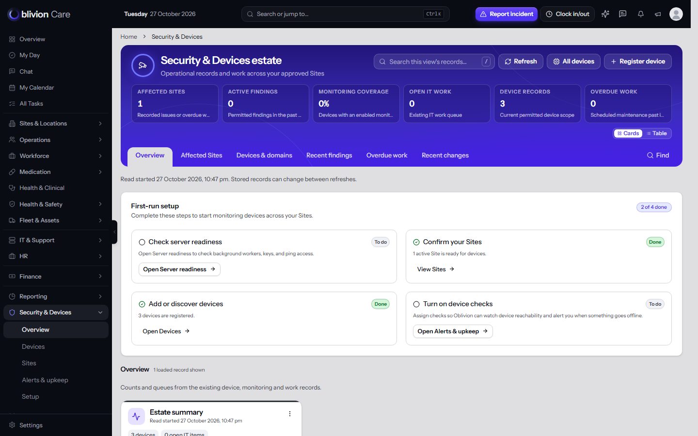
- **Devices list (`Not monitored` shown instead of `Healthy` without active checks):**
  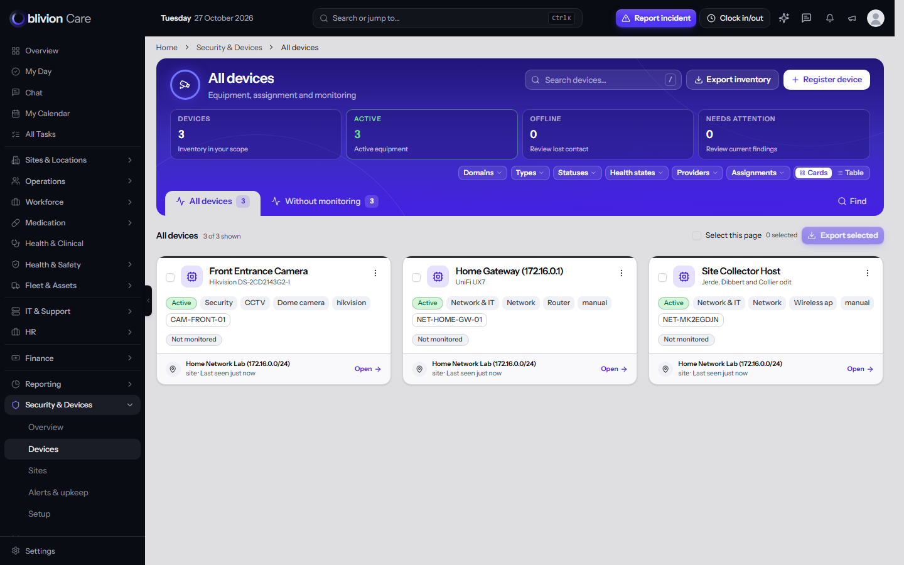
- **CCTV source honesty (`Source configured (not verified)` instead of `Live source verified`):**
  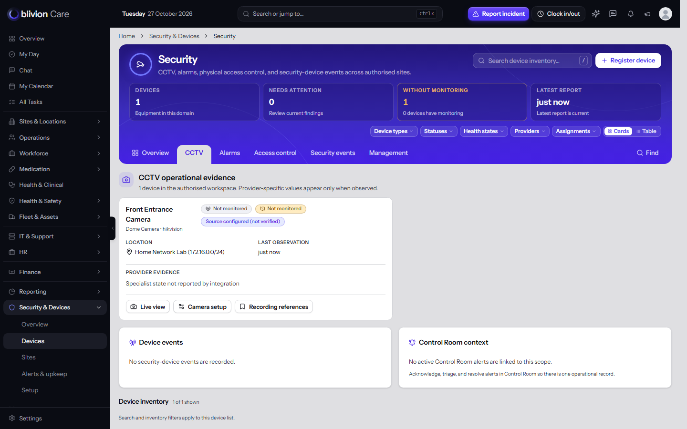
- **Network device profile (fake configuration backup hidden):**
  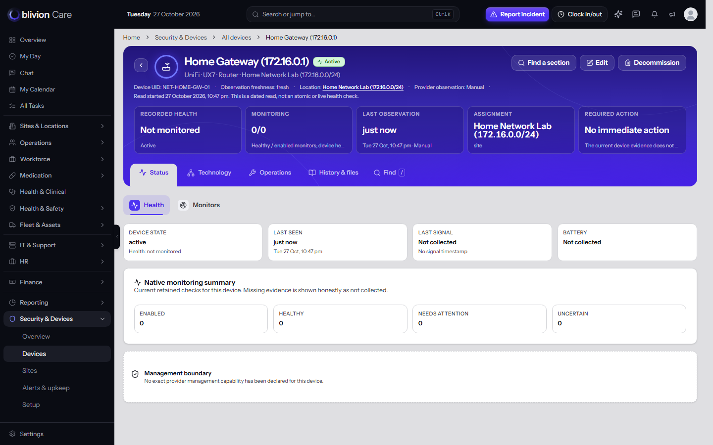
- **Settings › Server readiness:**
  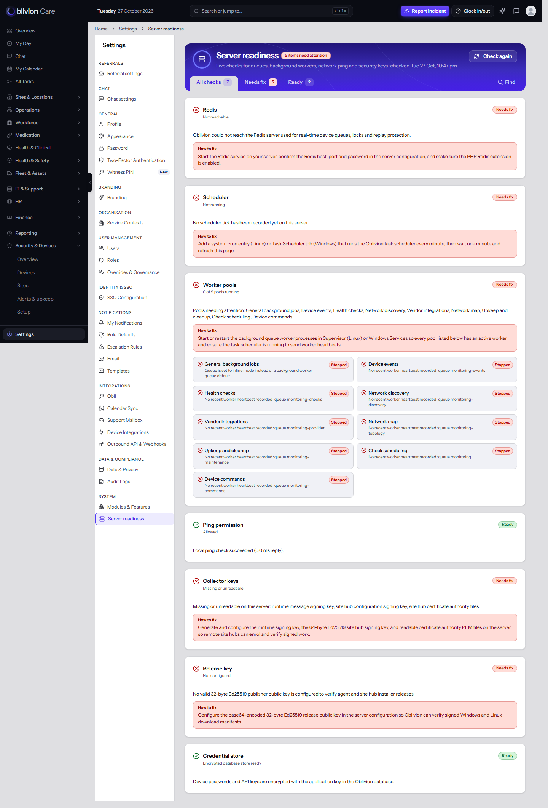

#### Live `oblivionfindings.com` walkthrough (`254675f68` — post-purge)
- **Live Server readiness (`5` of `7` ready, `2` honestly flagged for Phase 2 keys):**
  - `Redis`: **Ready** (`Connected and responding`)
  - `Scheduler`: **Ready** (`Running every minute`)
  - `Worker pools`: **Ready** (`9 of 9 pools running`)
  - `Ping permission`: **Ready** (`Allowed · Local ping check succeeded`)
  - `Credential store`: **Ready** (`Encrypted database store ready`)
  - `Collector keys`: **Needs fix** (`Missing or unreadable: site hub configuration signing key, site hub certificate authority files` — scheduled for Phase 2 with server owner approval)
  - `Release key`: **Needs fix** (`No valid 32-byte Ed25519 publisher public key is configured` — scheduled for Phase 2)
- **Overview (`3` real devices, `0%` monitoring coverage, `First-run setup` `2 of 4 done`):**
  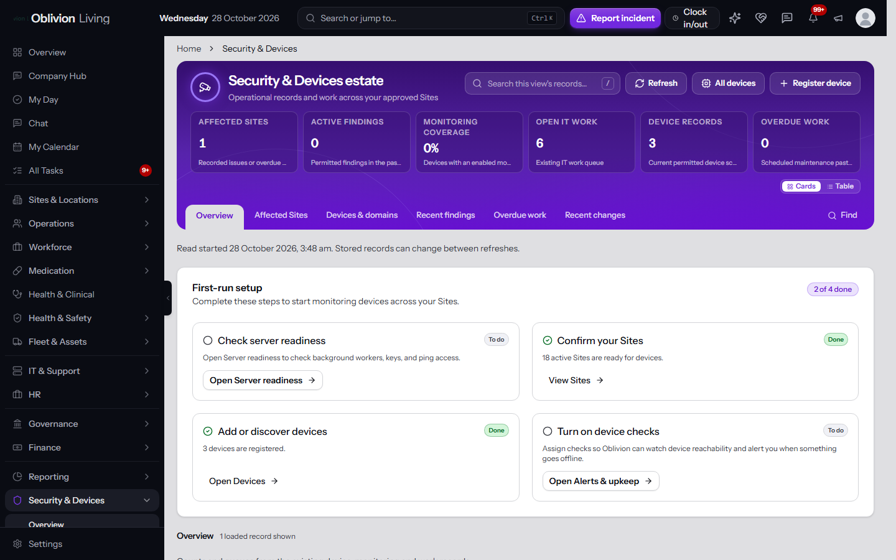
- **Devices list (`Care tracker 867963069916998`, `unif`, `UX7` — all 22 test devices removed, `Not monitored` shown honestly):**
  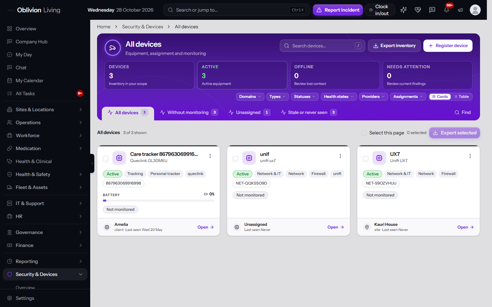
- **Device profile (`UX7` — `Not monitored`, `History & files` plain tab, fake configuration backup hidden):**
  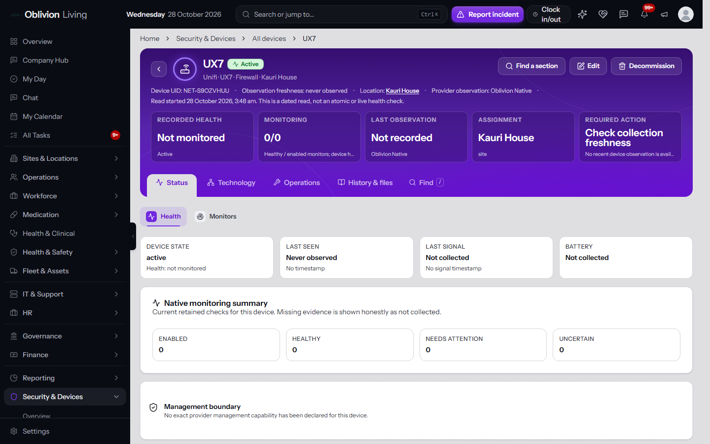
- **Alerts & upkeep (`/security-devices/monitoring` — consolidated section tabs, `0` fixture checks remaining):**
  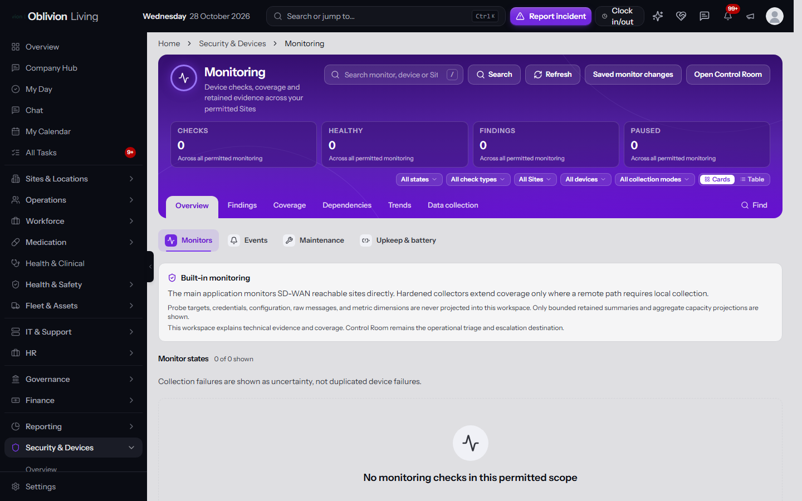
- **Settings › Server readiness (live `oblivionfindings.com` checks):**
  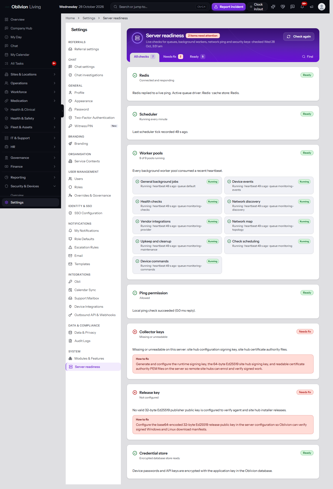

---

## Phase 1 — The basics

### Summary of changes

1. **Edit device (`1.1`) & Register device (`1.2`)**
   - Updated `AddDeviceDialog` / `EditDeviceDialog` (`resources/js/components/security-devices/add-device-dialog.tsx`) and `DeviceController` (`app/Domain/SecurityDevices/Http/Controllers/DeviceController.php`) so both registration and editing expose a searchable Site combobox (`Popover` + `Command`) and **IP address or hostname** on Step 1 (**Classification**), alongside name, workspace/category/type, manufacturer/model, and notes.
   - `DeviceController::store` and `DeviceController::update` accept IPv4, IPv6, or RFC-1123 hostnames (`ipOrHostnameRules()`) and atomically assign, transfer, or release Site assignments (`DeviceAssignmentService`) while guarding non-Site person/room/vehicle assignments.

2. **`Ping now` on device profiles (`1.3`)**
   - Added `POST /security-devices/devices/{device}/ping` (`DevicePingController`) backed by `DnsResolver`, `EgressPolicy` (`deny_cidrs` SSRF protection preserved), and `IcmpTransport` (`NativeIcmpTransport`).
   - Added the **Connection test** card on `Status › Health` (`resources/js/pages/security-devices/devices/device-profile-sections.tsx`) showing live reply time (`< 1 ms`, `X ms`) or a plain-English failure reason (`missing_address`, `dns_failed`, `address_blocked`, `unreachable`, `timeout`, `permission_denied`).

3. **One-switch `"Alert me if this goes offline"` & seeded default profile (`1.4`)**
   - Added migration `2026_10_28_000001_seed_default_availability_profile.php` (`MonitoringProfile::DEFAULT_AVAILABILITY_NAME = 'Standard availability'`: 60s interval, 3 failure confirmations, 2 recovery confirmations, 300s stale threshold).
   - Added `POST /security-devices/devices/{device}/offline-alert` (`DeviceOfflineAlertController`) and the one-switch **Alert me if this goes offline** card on device profiles, auto-provisioning or toggling the Site's `'Registered device hosts'` scope (`/32` or `/128` host CIDR), `'Standard availability'` profile, and ICMP availability check.

4. **Always-visible `"Add check"` with plain-English missing-prerequisite guidance (`1.5`)**
   - Updated `DeviceProfilePresenter`, `MonitoringOperationsPresenter`, `device-profile-sections.tsx`, `monitoring.tsx`, and `native-monitor-dialogs.tsx` so **Add check** is always visible on device profiles and **Alerts & upkeep**, disabling cleanly with a plain-English explanation and shortcut button when a Site assignment, monitoring profile, or eligible device is missing.

5. **Discovery candidate review actions (`1.6`)**
   - Wired `DiscoveryCandidateService` (`adopt`, `sameAs`, `ignore`, `adoptAll`) to `DiscoveryCandidateReviewController`, `DiscoveryOperationsPresenter`, `discovery-candidate-dialogs.tsx`, and `discovery.tsx` (`Setup › Discovery & hubs › Candidates`).
   - Supports **Add as device**, **Same as…** (searchable Site device combobox that fills missing IP/MAC/hostname on the existing device), **Ignore**, and **Add all** (`ConfirmDialog`), normalising 12-hex MACs to `AA:BB:CC:11:22:33` without leaking raw `evidence_snapshot` payloads.

6. **Queclink unit console (`1.7`)**
   - Added `QueclinkUnitConsoleService`, `QueclinkUnitConsoleController`, `CommandBuilder::watchdogReboot` (`AT+GTDOG`), `queclink-unit-console.tsx`, and `docs/security-devices/SUPPORTED-DEVICES.md` citing the official *Queclink GL30MEU @Track Air Interface Protocol Specification* (`GL30MEUR01`, Rev. 2.04) and *GL320MG User Manual* (`GL320MGUM001`).
   - Renders on **Technology › Unit console** for Queclink trackers and via direct console links on `/security-devices/integrations/queclink`.
   - Masks IMEIs (`8679•••••••6998`), scrubs command passwords (`[REDACTED]`), enforces `PersonalTrackingPrivacyService` + `device_assignment_id` historical frame privacy so prior unconsented resident coordinates never leak after reassignment, and separates read-only queries (`Request current location`, `Read configuration`, `Request device status`) from confirmation-and-audit-reason gated changes (`Update reporting interval`, `Update scheduled watchdog`, `Reboot tracker`).

---

### Verification & local walkthrough

- **Laravel Pint:** 0 issues across all touched/new PHP files.
- **TypeScript (`tsc --noEmit`):** 0 errors across the repository.
- **ESLint (`--max-warnings=0`):** 0 errors and 0 warnings across all 16 touched/new TS/TSX files (including `security-devices-copy/no-jargon`).
- **Vitest (`--maxWorkers=2`):** 4 test files / 55 tests passed (`add-device-dialog.test.tsx`, `queclink-unit-console.test.tsx`, `monitoring.test.tsx`, `discovery.test.tsx`).
- **Pest:**
  - Architecture (`ItSecuritySingleTenantBoundaryTest`, `DeviceCommandOperationalBoundaryTest`, `MonitoringProbeEgressBoundaryTest`, `MonitoringSingleTenantBoundaryTest`): all passed (48+ tests, 657+ assertions).
  - Feature (`Phase1DeviceBasicsTest`, `DiscoveryCandidateActionsTest`, `QueclinkUnitConsoleTest`, `SettingsAuditTest`, `OperationsWorkspacesTest`, `DiscoveryIdentityTest`, `DiscoveryRunTest`): 69 passed (944 assertions).
- **Home network walkthrough (`172.16.0.0/24`):**
  - Registered `Home Gateway UX7` assigned to `Home Network Lab (172.16.0.0/24)` with IP `172.16.0.1` (`1.2`), verified `Edit device` prefill (`1.1`).
  - `Ping now` on `172.16.0.1` → `< 1 ms` (`Replied in < 1 ms.`) + toggled **Alert me if this goes offline** ON (`Offline alerts are on for 172.16.0.1.`) (`1.3`, `1.4`).
  - `Ping now` on `172.16.0.253` (unassigned LAN host) → `No reply` (`The network reported that this address is unreachable from the server.`) (`1.3`).
  - Unassigned `Spare Shelf Switch` (no Site, no IP) → **Add check** remains visible (`disabled`) with `Assign this device to a Site first so checks know where it lives.` and **Edit device** shortcut (`1.5`).
  - Exercised `Ignore`, `Same as…`, and `Add all` on Discovery › Candidates (`1.6`).
  - Exercised `Request current location` (`AT+GTRTO=[REDACTED],1,,,,,,6CC5$`) on `Care tracker 867963069916998` unit console with masked IMEI `8679•••••••6998` (`1.7`).

#### Local walkthrough screenshots
- **Register device (searchable Site combobox + IP address on Step 1):**
  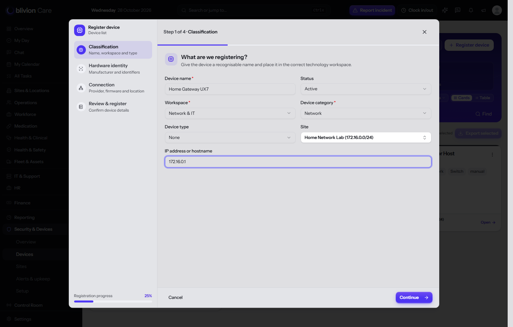
- **Edit device (prefilled Site + IP/hostname):**
  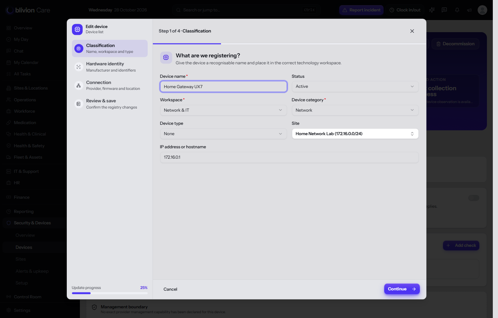
- **`Ping now` (`< 1 ms` reply on `172.16.0.1`) + one-switch `"Alert me if this goes offline"` ON:**
  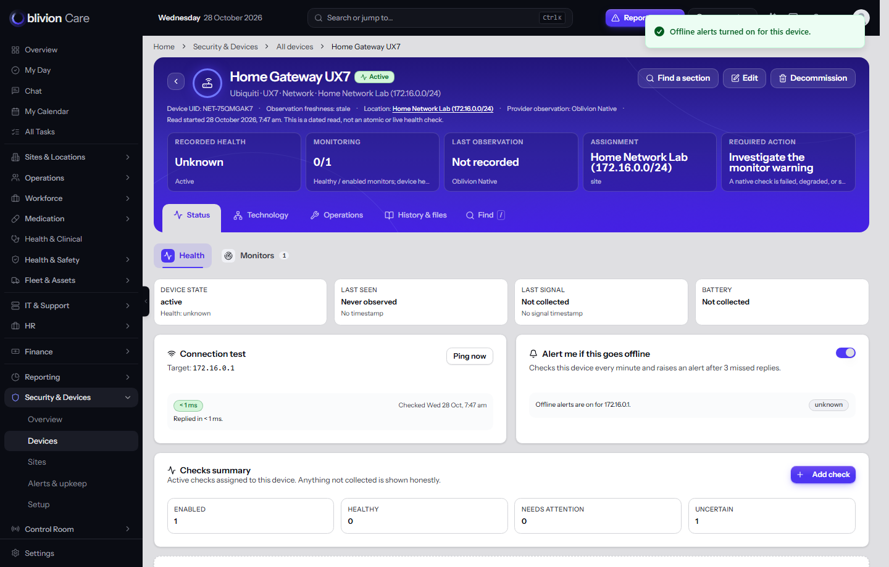
- **`Ping now` plain-English unreachable reason (`172.16.0.253`):**
  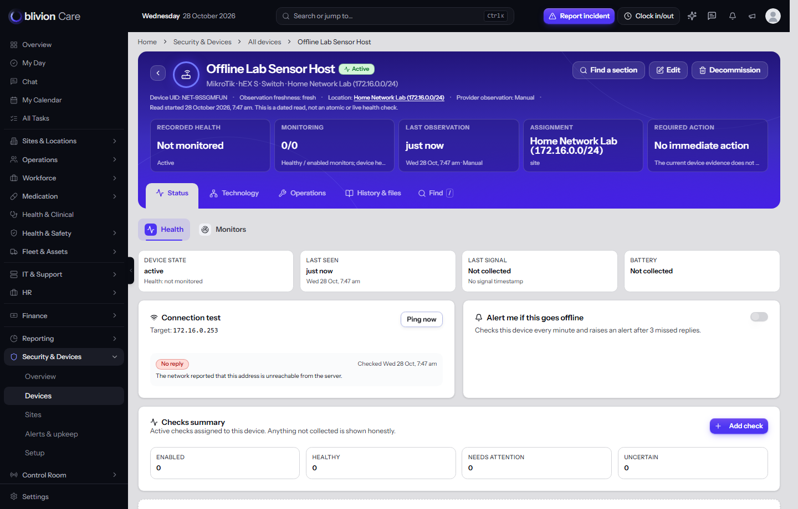
- **Always-visible `"Add check"` with plain-English missing-Site reason:**
  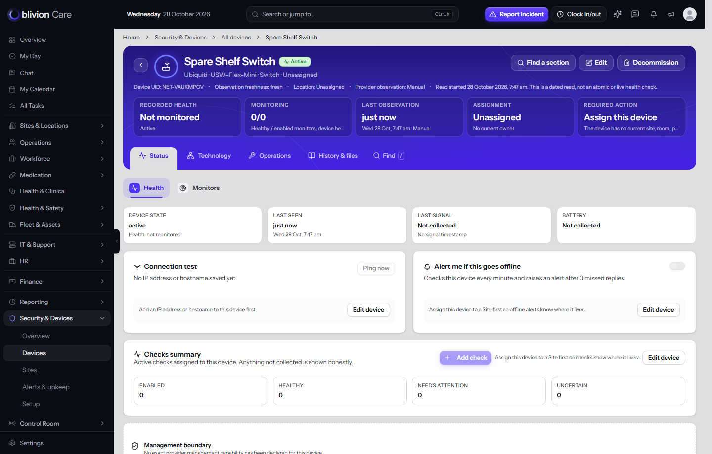
- **Discovery › Candidates (`Add all` + per-candidate review actions):**
  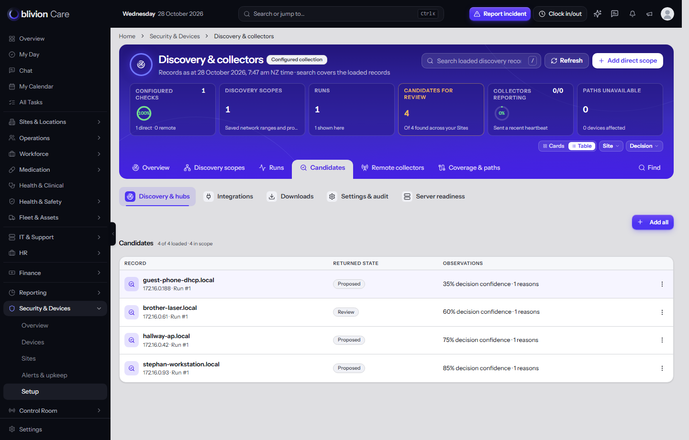
- **Queclink unit console (masked IMEI, redacted command password, protocol citation, safe vs confirmation-gated commands):**
  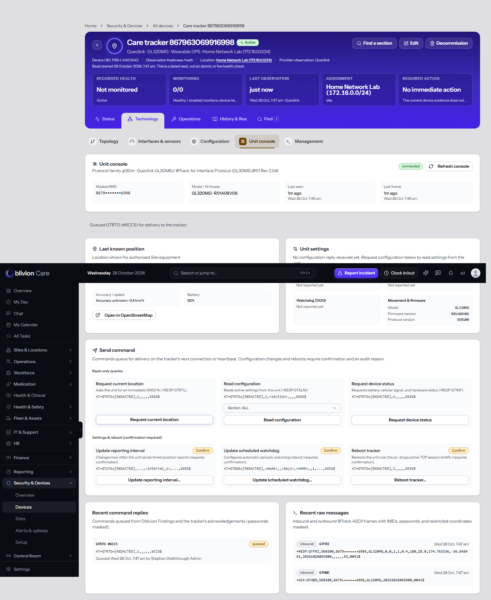

#### Live `oblivionfindings.com` walkthrough (`effbd5f8f` — 28 Oct 2026 NZDT)
- **Pre-deploy MySQL backup verified on `oblivionfindings.com`:**
  - `/home/oblivion/db-backups/oblivionfindings-pre-phase1-20261027T185427Z.sql.gz` (`45 MB`, `0600`, `gzip -t` OK)
- **Live deployment & migration verified:**
  - `deploy done current=effbd5f8f813e9f0d5cf46475d044c77d145d7a4`, `2026_10_28_000001_seed_default_availability_profile .............. [227] Ran`, `git -C /var/www/oblivionfindings status --porcelain` empty.
- **Register device (searchable Site combobox + IP address or hostname on live `.com`):**
  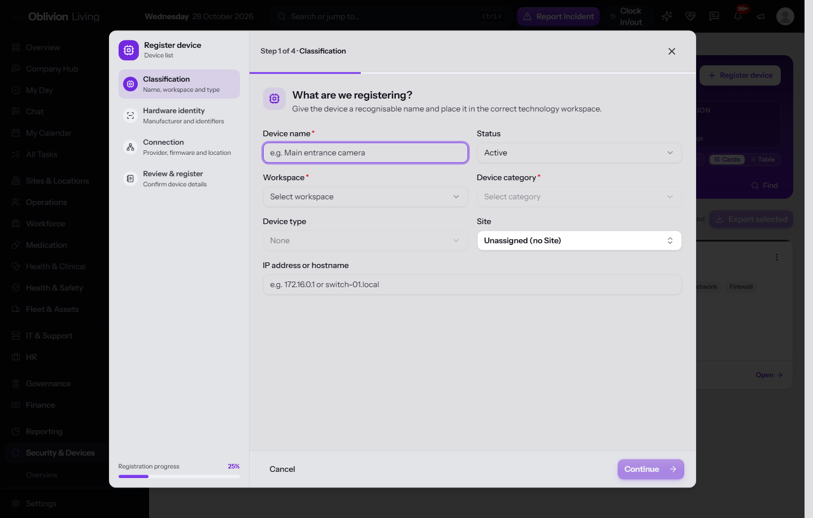
- **Edit device (`UX7` prefilling `Network & IT`, `Site: Kauri House`, `IP address or hostname: 172.16.0.1`):**
  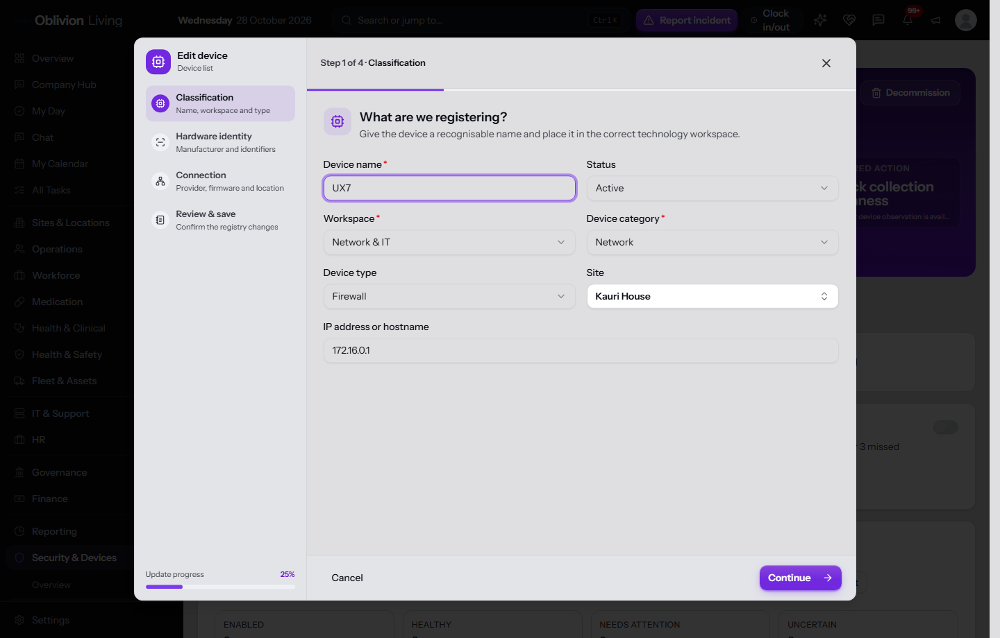
- **`Ping now` (`1 ms` live reply on `UX7`) + one-switch `"Alert me if this goes offline"` + always-visible `Add check` with plain-English prerequisite note:**
  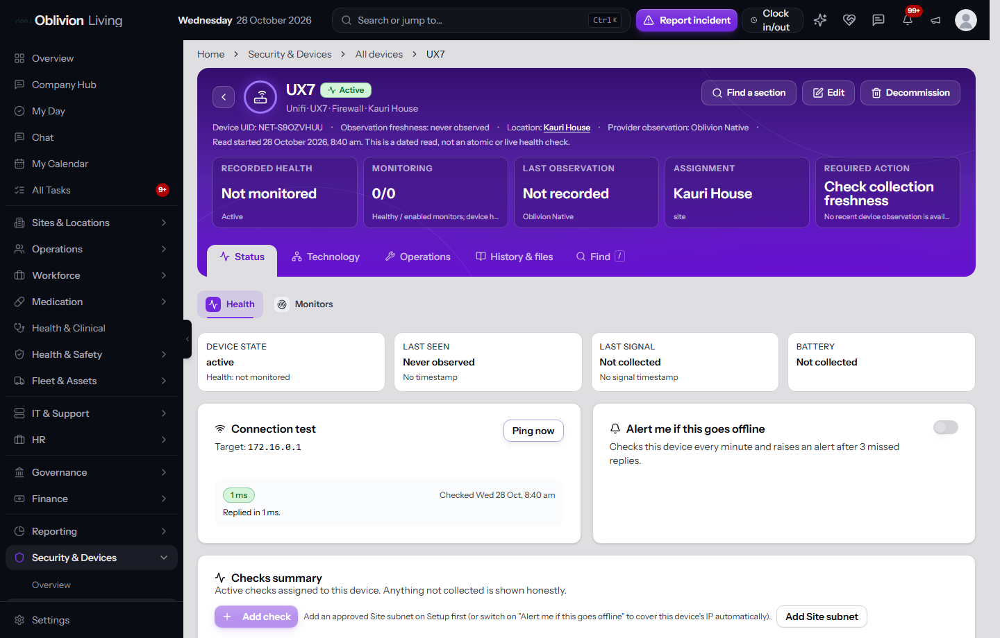
- **Discovery & collectors › Candidates (`No candidates in this Site view`, `0` console/page errors):**
  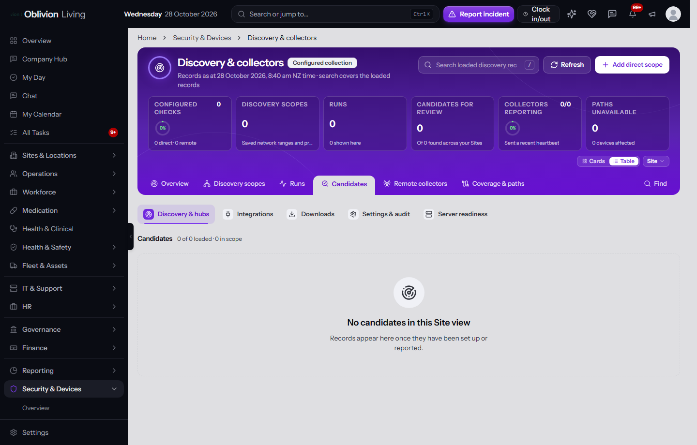
- **Queclink unit console on live `Care tracker 867963069916998` (`Amelia Wilson` resident location consent enforced, masked IMEI `8679•••••••6998`, historical `AT+GTRTO=[REDACTED]` / `AT+GTCFG=[REDACTED]` passwords scrubbed):**
  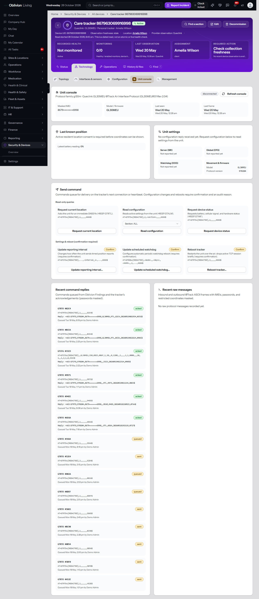

---

## Phase 2 — Site hub

### Summary of changes

1. **Multi-platform build, unsigned Windows installer, Linux systemd service, and Ed25519 release manifest (`2.1`)**
   - Added `.github/workflows/site-hub-release.yml` to build `windows/amd64`, `windows/arm64`, `linux/amd64`, and `linux/arm64` packages and sign `downloads.json` (`oblivion-endpoint-release-catalogue-v1`) with Ed25519.
   - Updated the Windows WPF installer (`endpoint-agent/installer/Obli.Setup`) and `endpoint-agent/cmd/oblivion-setup` so unsigned Windows installers (`obli-setup-windows-amd64.exe`, `obli-setup-windows-arm64.exe`) let operators install **Obli + computer agent**, **Site monitoring**, or **both**, and accept `ofh1_...` one-time setup codes directly without requiring JSON profile files.
   - Added `scripts/package-linux-site-hub.sh` and `endpoint-agent/packaging/linux/` (`install.sh --code 'ofh1_...'` + hardened `oblivion-site-collector.service` systemd unit with `AmbientCapabilities=CAP_NET_RAW`) for Linux x86_64 NUCs and ARM64 Raspberry Pi appliances.
   - Added `php artisan endpoint:publish-catalogue` (`PublishEndpointReleaseCatalogueCommand`) to verify the Ed25519 catalogue signature and SHA-256 package digests before atomically publishing releases into `storage/app/private/endpoint-releases`.
   - Fixed `OpenSslCollectorCertificateIssuer` on Windows hosts by passing the OpenSSL config path during private key export (`openssl_pkey_export`).

2. **`"Add a hub"` wizard per Site (`2.2`)**
   - Added migration `2026_10_28_090000_add_hub_metadata_to_collector_enrollments.php`, `SiteHubWizardController` (`options`, `issue`, `status`), `AddHubWizard` (`resources/js/components/security-devices/add-hub-wizard.tsx`), and `EditHubDialog` (`resources/js/components/security-devices/edit-hub-dialog.tsx`).
   - Guides operators through selecting the Home Site, hub name, platform (**Windows PC or server** vs **Linux NUC or Raspberry Pi**), and optional SD-WAN/MPLS Sites, then provides verified installer downloads, a 15-minute `ofh1_...` one-time setup code (plus Linux `sudo bash install.sh --code '...'`), and live connection polling until **`Connected ✓`**.

3. **Assign checks & scans to hubs, SD-WAN multi-Site coverage, server-direct scanning, and `"Runs from"` (`2.3`)**
   - Extended `MonitoringCollector` (`coveredSiteIds()`, `authorisedSiteIds()`, `softwareVersion()`), `CollectorEnrollmentService`, `CollectorConfigurationService`, `CollectorIngestService`, `CollectorCredentialLeaseSealer`, `MonitoringObservationScopeGuard`, `MonitorScheduler`, `DiscoveryScopeValidator`, `DiscoveryRunner`, `NativeMonitoringDefinitionService`, `NativeMonitorCommandService`, and `collector/` (`CollectorConfig`, `ScopeGuard`, `CollectorApplication`) so one Site hub can run local checks and discovery scans for its Home Site **and** explicitly covered SD-WAN/MPLS Sites (`config.covered_site_ids`) while failing closed for unauthorised Sites.
   - Server-direct monitors and scans (`collector_id = null`) continue to run directly from the application server when routable.
   - Surfaced **`Runs from: server`** / **`Runs from: hub <Name>`** across Discovery scopes & runs, Alerts & upkeep (`/security-devices/monitoring`), Device profiles (and the `Add check` / `Add scope` wizards), and Site technology views.

4. **Hub health on Discovery & collectors and Site technology (`2.4`)**
   - Surfaced live hub status (`Online` / `Stale` / `Offline`), software version (`v0.2.0`), last heartbeat & integer lag seconds, active check & scan load, and SD-WAN covered Sites (including `Covers over SD-WAN` badges on remote Sites) on **Setup › Discovery & collectors** and **Sites › Site technology**.

---

### Verification & local walkthrough

- **Go (`endpoint-agent/`):** `go test ./...` — passed.
- **Windows WPF (`endpoint-agent/installer/Obli.Setup/`):** `dotnet build` — 0 errors, 0 warnings.
- **Collector PHP runtime (`collector/`):** `php vendor/bin/pest --compact` — 122 passed (797 assertions).
- **Laravel Pint:** 0 issues across all touched/new PHP files.
- **TypeScript (`tsc --noEmit`):** 0 errors across the repository.
- **ESLint (`--max-warnings=0`):** 0 errors and 0 warnings across all 15 touched/new TS/TSX files (including `security-devices-copy/no-jargon`).
- **Vitest (`--maxWorkers=2`):** 8 test files / 76 tests passed (`add-hub-wizard.test.tsx`, `native-monitor-wizard.test.tsx`, `discovery.test.tsx`, `collector-lifecycle.test.tsx`, `monitoring.test.tsx`, `native-monitoring-workflows.test.tsx`, `sites/show.test.tsx`, `security-devices-confirmation-dialogs.test.ts`).
- **Pest (Sequential):** `ItSecuritySingleTenantBoundaryTest`, `MonitoringSingleTenantBoundaryTest`, `NativeMonitoringOperatorWorkflowTest`, `MonitoringCollectorOperatorWorkflowTest`, `EndpointDownloadsTest`, `CollectorLifecycleTest`, `CollectorRecoverableEnrollmentTest`, `Phase2SiteHubTest` — 103 passed (2,898 assertions).
- **Home network walkthrough (`172.16.0.0/24`):**
  - Published a signed multi-platform `0.2.0` catalogue (`windows/amd64`, `windows/arm64`, `linux/amd64`, `linux/arm64`) via `php artisan endpoint:publish-catalogue` (`2.1`).
  - Issued an `ofh1_...` setup code for `Home Network Lab Hub` (covering `Remote Branch SD-WAN` over SD-WAN), enrolled via `CollectorRecoverableEnrollment` with real OpenSSL mTLS client certificate issuance, and verified Step 3 transitioning live to **`Connected ✓`** on `v0.2.0` (`2.2`).
  - Ran a rate-limited server-direct check against `172.16.0.1` (`Replied in < 1 ms.`, `Runs from: server`) alongside a hub-assigned SD-WAN scope (`172.16.0.128/28`) and check (`172.16.0.130`, `Runs from: hub Home Network Lab Hub`) (`2.3`, `2.4`) with `0` console/page/HTTP errors.

#### Local walkthrough screenshots
- **Add a Site hub — Step 1 (Home Site, Windows/Linux selector, SD-WAN Site coverage):**
  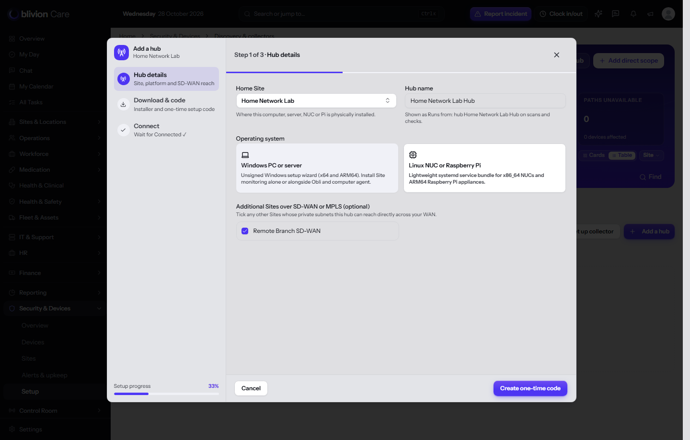
- **Add a Site hub — Step 2 (Signed installer downloads + one-time `ofh1_...` setup code):**
  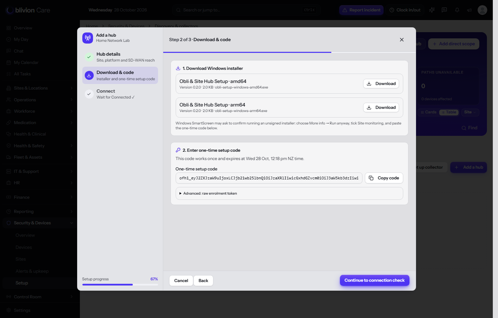
- **Add a Site hub — Step 3 (`Connected ✓` live heartbeat on `v0.2.0`):**
  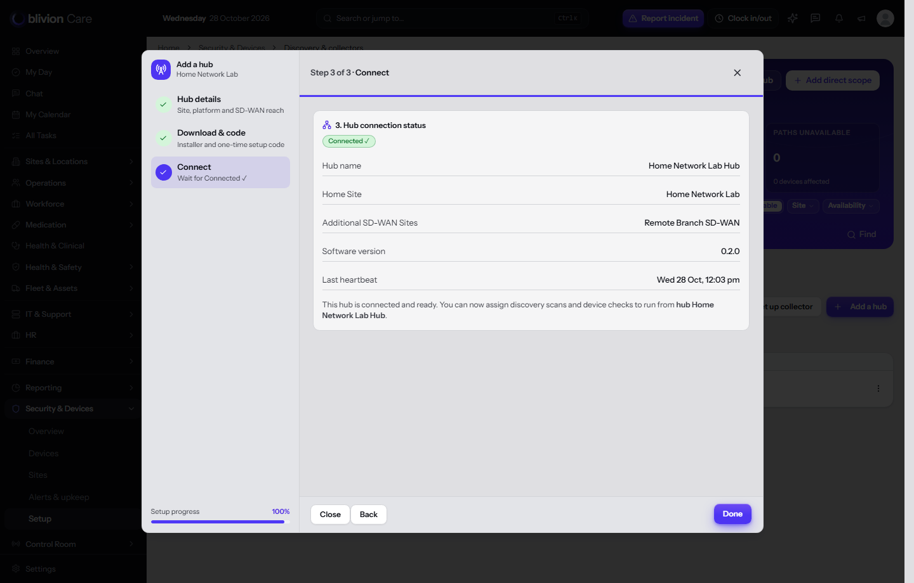
- **Setup › Discovery & collectors — Hub health (`Online`, `v0.2.0`, check & scan load, `Remote Branch SD-WAN`):**
  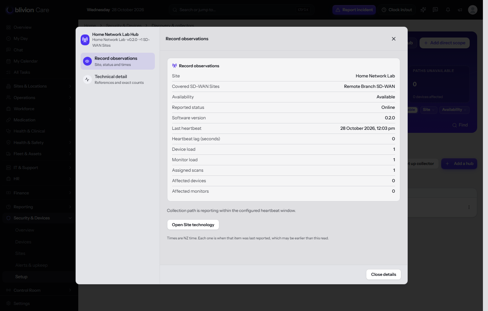
- **Setup › Discovery & collectors — Scopes (`Runs from: server` & `Runs from: hub Home Network Lab Hub`):**
  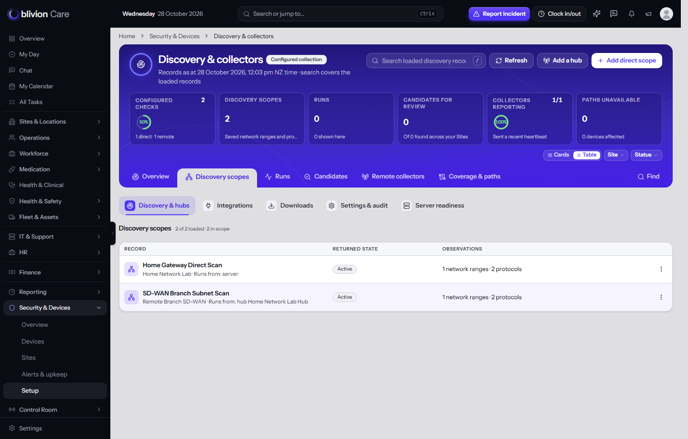
- **Alerts & upkeep — Monitors (`Runs from: server` & `Runs from: hub Home Network Lab Hub`):**
  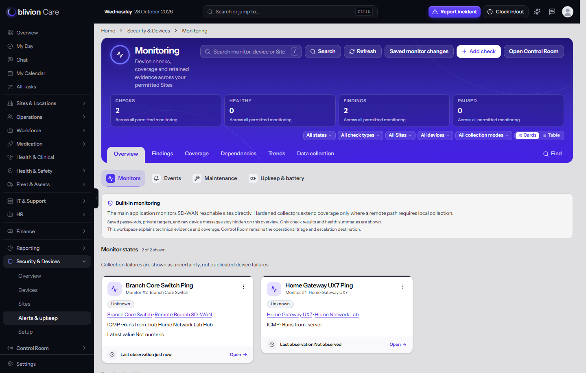
- **Device profile — Monitors (`Runs from: hub Home Network Lab Hub`):**
  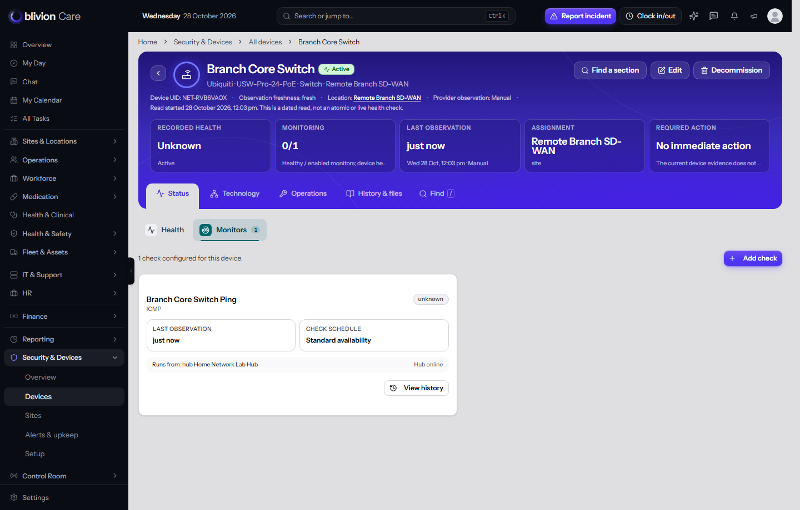
- **Site technology (`Remote Branch SD-WAN`) — `Covers over SD-WAN` hub card (`v0.2.0`):**
  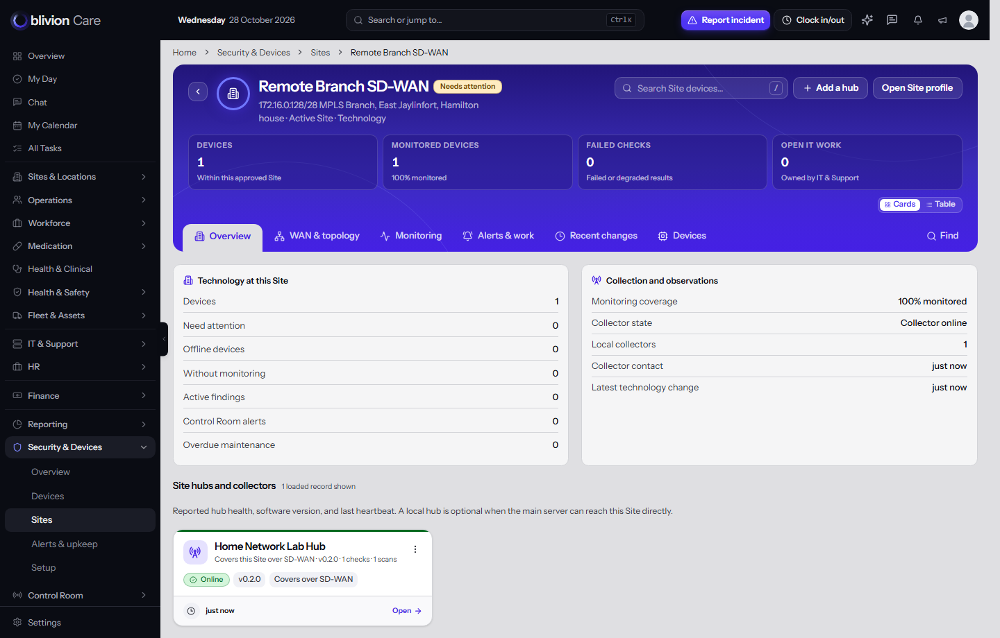

#### Live `oblivionfindings.com` walkthrough (`a6eae4cfd` — 28 Oct 2026 NZDT)
- **Pre-deploy MySQL backup verified on `oblivionfindings.com`:**
  - `/home/oblivion/db-backups/oblivionfindings-pre-phase2-20261028T005600Z.sql.gz` (`45 MB`, `0600`, `gzip -t` OK)
- **Live infrastructure & signed release catalogue (`7 of 7` Server readiness checks Ready):**
  - Internal Site hub Root CA + Intermediate CA generated under `/etc/oblivion-collector-ca` (`0600` keys), Nginx `ssl_verify_client optional` header forwarding wired on `127.0.0.1:18443` (`/api/v1/monitoring/collector/`), and Ed25519 config-signing + release-verification keys added to live `.env`.
  - GitHub Actions `Site Hub Release` (`40611595113`) built and Ed25519-signed `windows/amd64`, `windows/arm64`, `linux/amd64`, and `linux/arm64` `0.2.0` packages (`141.2 MB` / `151.0 MB` Windows installers + `7.3 MB` / `6.6 MB` Linux service archives), published atomically via `php artisan endpoint:publish-catalogue`.
- **Settings › Server readiness (`All checks 7`, `Needs fix 0`, `Ready 7`):**
  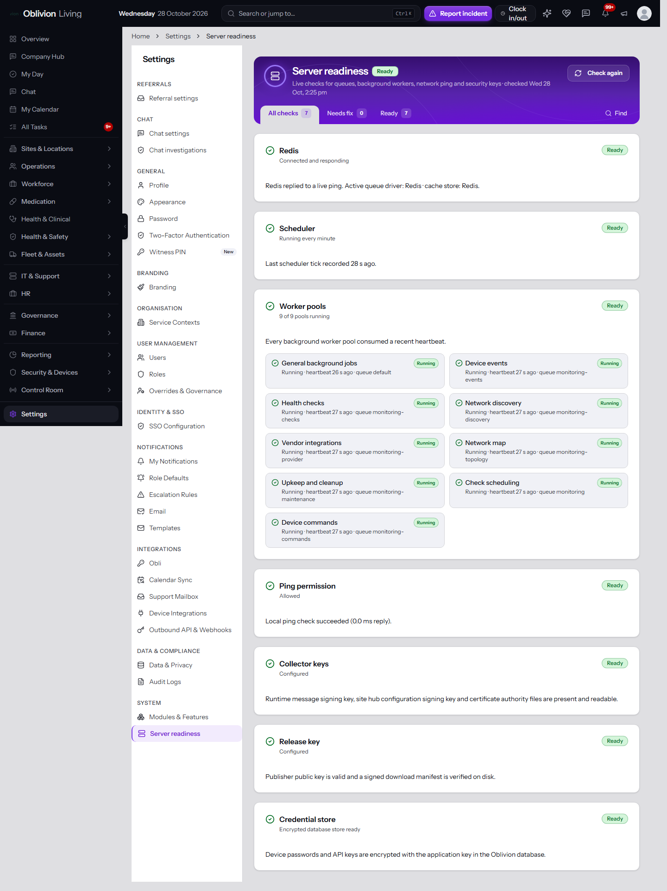
- **Agent downloads (`8 Published releases`, `Version 0.2.0` signed Windows + Linux bundles):**
  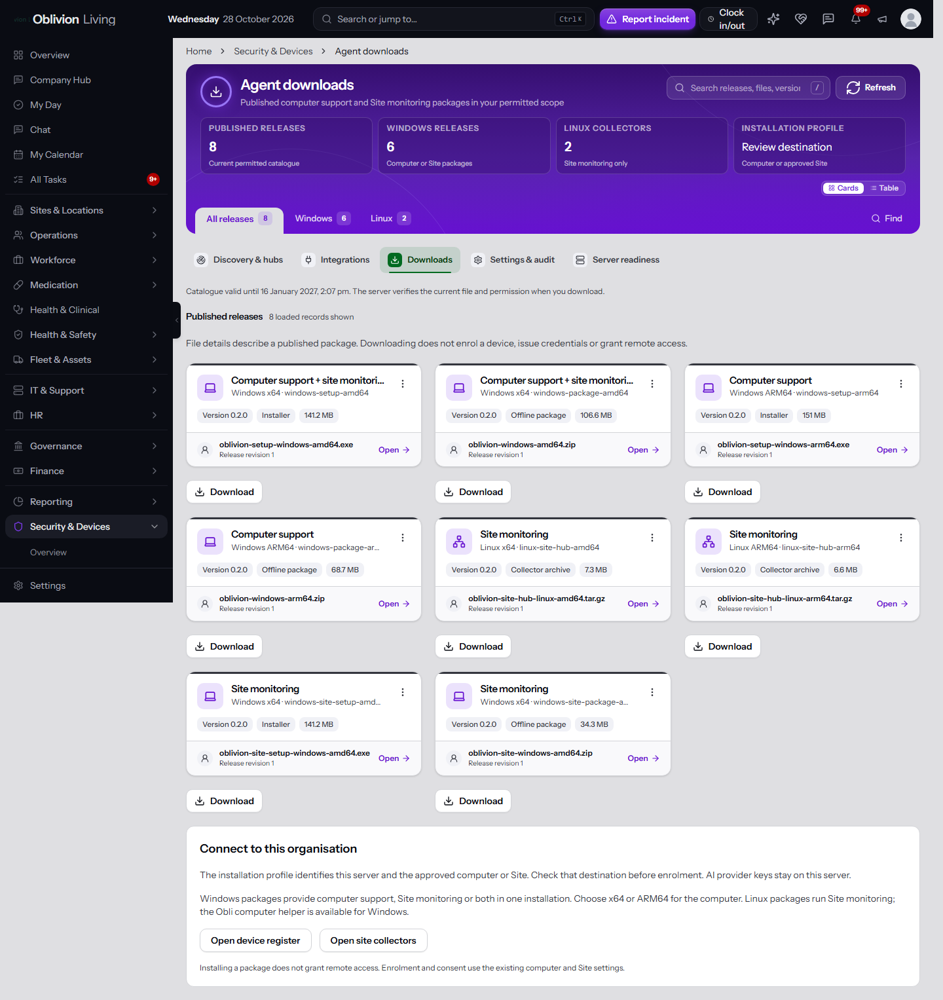
- **Add a Site hub — Step 1 (`Kauri House` + `Rimu House` SD-WAN ticked):**
  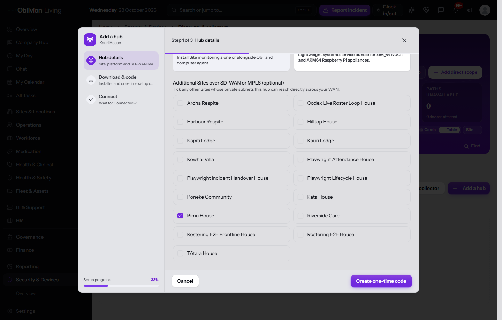
- **Add a Site hub — Step 2 (Signed `0.2.0` Windows installers + one-time `ofh1_...` setup code):**
  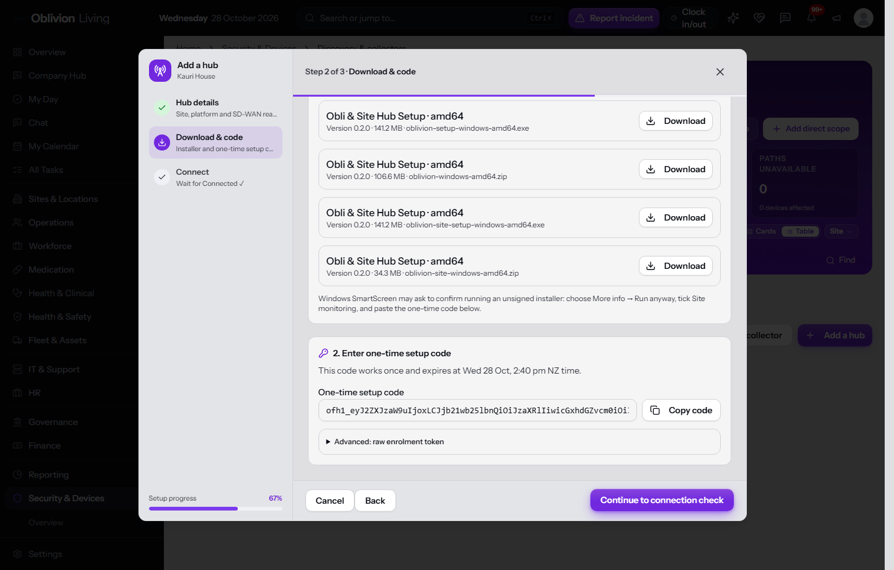
- **Add a Site hub — Step 3 (`Connected ✓` after real HTTPS + SPKI-pinned + mTLS enrolment & heartbeat from `172.16.0.93`):**
  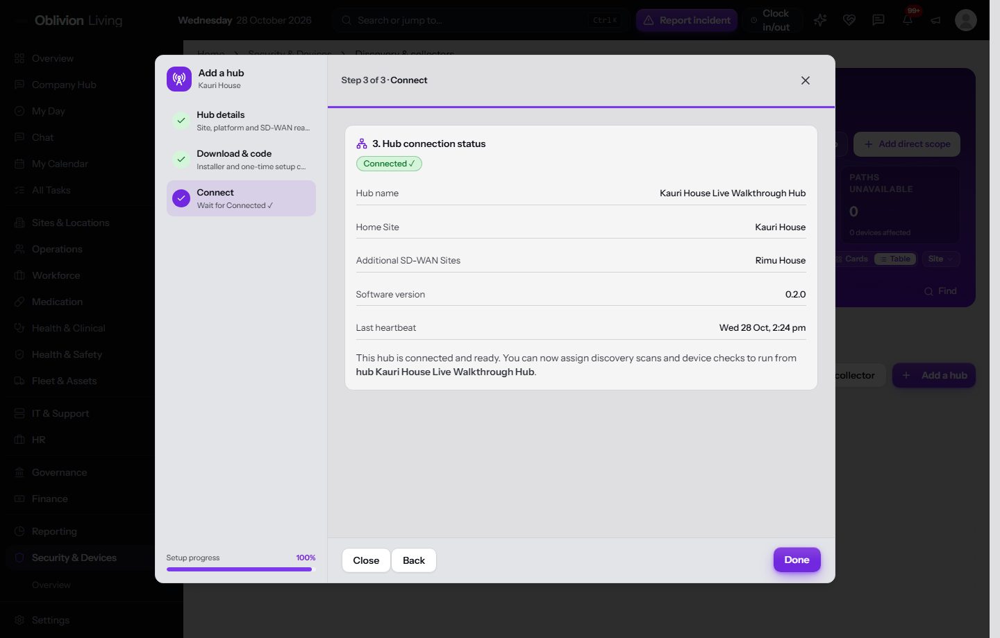
- **Discovery & collectors — Remote collectors (`1/1` reporting, `Kauri House Live Walkthrough Hub` `v0.2.0 · +1 SD-WAN Sites`):**
  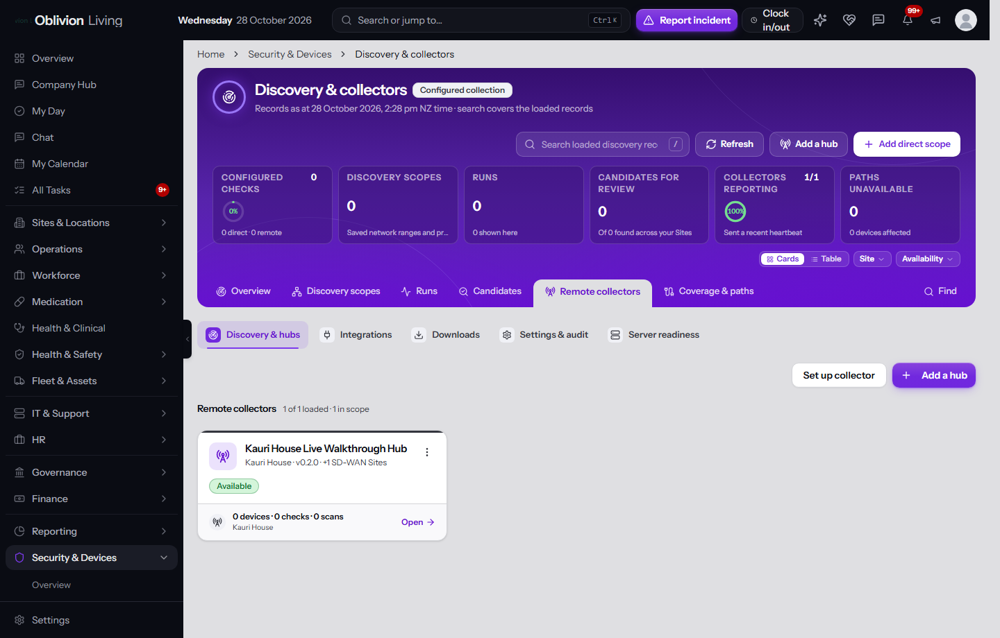
- **Site technology (`Rimu House`) — `Covers over SD-WAN` (`Online`, `v0.2.0`):**
  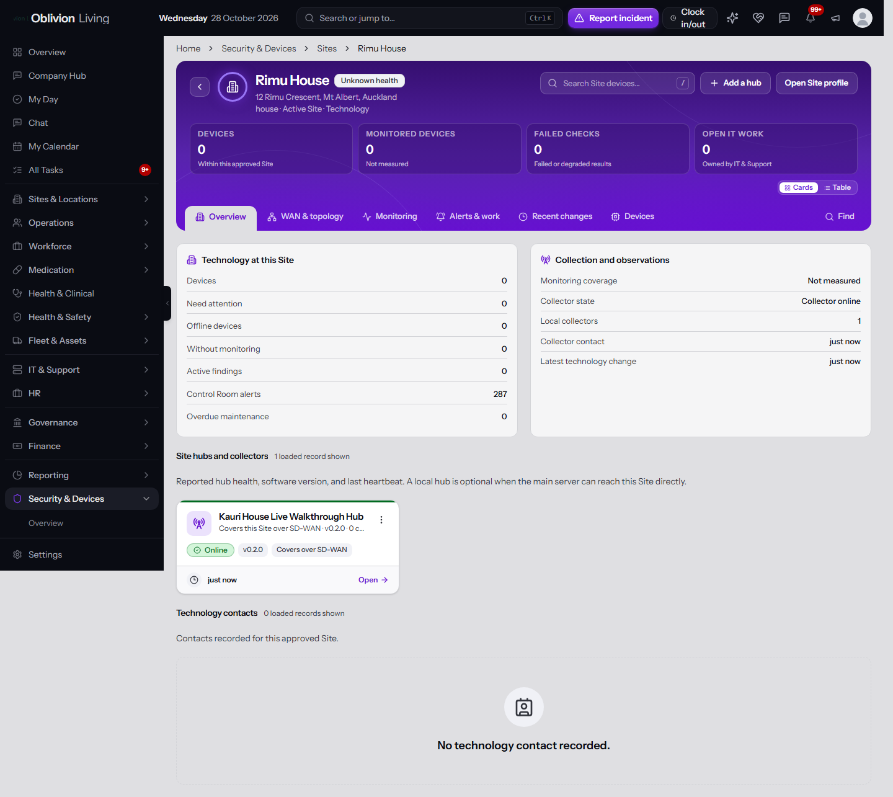
- **Device profile (`UX7`) — Live check status (`Replied in 1 ms.`):**
  

---

## Phase 3 — Find & identify

### Summary of changes

1. **Multi-protocol rate-limited network discovery across both Site hubs and server-direct (`3.1`)**
   - Built `LanDiscoveryScanner` (`collector/src/Discovery/LanDiscoveryScanner.php`) and `LocalLanDiscoveryScanner` (`app/Domain/Monitoring/Discovery/Support/LocalLanDiscoveryScanner.php`) so both the Site hub (`RemoteDiscoveryRunner`) and server-direct (`NetworkSeedDiscoveryAdapter`) sweep approved subnets with rate-limiting (`packets_per_second`) across all 10 native protocols:
     - **ICMP (`icmp`):** Genuine echo-reply ping verification (hardened in `collector/src/Runtime/ProbeRunner.php` so Windows `Reply from <router>: Destination host unreachable` is rejected instead of falsely passing `exit 0`).
     - **ARP / neighbour table (`arp`):** Rate-limited local L2 ARP prewarm + `arp -a` / `ipconfig /all` (Windows) and `/proc/net/arp` / `ip neigh` (Linux), plus locally-administered private MAC detection.
     - **Async batched TCP (`tcp`) & HTTP/TLS (`http`, `tls`):** Concurrent `STREAM_CLIENT_ASYNC_CONNECT` port batching (`20` sockets per batch) with L2 dead-host fast-skip, scrubbed HTTP `Server` / `<title>` / `WWW-Authenticate` banners, and passive TLS X.509 SHA-256 fingerprint + certificate `CN` / `O` extraction.
     - **Pure-PHP SNMP v2c & v3 (`snmp`):** Implemented `SnmpSystemProbe` (`collector/src/Discovery/SnmpSystemProbe.php` & `app/Domain/Monitoring/Discovery/Support/SnmpSystemProbe.php`) in pure PHP ASN.1 BER (zero `ext-snmp` dependency) supporting read-only SNMPv2c (`public`) and sealed-lease SNMPv3 USM (`authPriv` / `authNoPriv` SHA-1..SHA-512 + AES-128) for `sysDescr.0`, `sysObjectID.0`, and `sysName.0`; made `snmp_credential_reference` optional on `DiscoveryScope`.
     - **Multicast & unicast naming (`mdns`, `ssdp`, `onvif`, `dns`):** RFC 6762 mDNS (`224.0.0.251:5353`), UPnP SSDP (`239.255.255.250:1900`) with SSRF-validated same-IP device description XML (`friendlyName`, `manufacturer`, `modelName`), ONVIF WS-Discovery (`239.255.255.250:3702` SOAP `ProbeMatches`), and unicast UDP 53 `IN PTR` reverse DNS.
   - Bundled the public IEEE OUI + MA-M registry (`46,453` prefixes) into `MacVendorLookup` (`app` + `collector`) for instant offline MAC vendor resolution.

2. **Device type, brand, model, confidence, and plain-English reason fingerprinting (`3.2`)**
   - Added `DeviceFingerprintService` (`app/Domain/Monitoring/Discovery/Services/DeviceFingerprintService.php`) and `DeviceIdentification` (`app/Domain/Monitoring/Discovery/Data/DeviceIdentification.php`) to combine ONVIF scopes/types, SNMP enterprise PENs + `sysDescr`, SSDP/UPnP XML, mDNS service records, HTTP/TLS banners, open service ports, hostnames, and IEEE OUI MAC vendors into canonical `DeviceTaxonomy` (`domain`, `category`, `subcategory`), `type_label`, `manufacturer`, `model`, `suggested_name`, `confidence` (`20`–`99` + `high`/`medium`/`low` band), and plain-English `reason` (e.g. `"ONVIF camera, Hikvision — matched ONVIF WS-Discovery + IEEE MAC vendor"`).
   - Extended `DeviceTaxonomy` with `media_display` and `mobile_device` under `it_infrastructure / endpoint` so discovered Smart TVs/Cast displays and Wi-Fi phones/tablets map cleanly without falling back to network switches.

3. **Candidate review screen, `Add all`, and pre-filled `Add as device` (`3.3`)**
   - Updated `DiscoveryCandidateService`, `DiscoveryOperationsPresenter`, `resources/js/pages/security-devices/discovery.tsx`, `resources/js/components/security-devices/discovery-candidate-dialogs.tsx`, and `resources/js/components/security-devices/discovery-scope-dialogs.tsx`:
     - Candidate cards, table rows, and the `Discovery details` drawer show fingerprinted `type_label`, `manufacturer` & `model`, `mac_vendor`, `identification_confidence`, plain-English `Why we think so`, `ip_address`, `mac_address`, and `open_ports`.
     - `Add as device` pre-fills `Device name`, `Device group` (`domain`), `Device type` (`category`), `Sub-type` (`subcategory`), `Brand` (`manufacturer`), and `Model` (`model`), while `Add all` adopts every unreviewed proposed candidate with its detected taxonomy, brand, and model.
     - Scope creation & editing wizards surface all 10 protocols with plain-English labels, portless `icmp`/`arp` handling, optional SNMP credential reference, and `Packets per second` rate limits.
   - Documented Phase 3 discovery protocols, official RFC/ONVIF/UPnP/IEEE citations, and real hardware verification in `docs/security-devices/SUPPORTED-DEVICES.md`.

---

### Verification & local walkthrough

- **Collector PHP runtime (`collector/`):** `php vendor/bin/pest --compact` — 126 passed (`Phase3DiscoveryTest`: live UDP BER SNMPv2c responder, Windows `Destination host unreachable` rejection, OUI/MA-M lookup, signal scrubbing).
- **Laravel Pint:** 0 issues across all touched/new PHP files.
- **TypeScript (`npm run types`):** 0 errors across the repository.
- **Prettier & ESLint (`--max-warnings=0`):** 0 errors and 0 warnings across `discovery.tsx`, `discovery-candidate-dialogs.tsx`, `discovery-scope-dialogs.tsx`, and `discovery.test.tsx` (including `security-devices-copy/no-jargon` and zero `text-xs text-muted-foreground`).
- **Vitest (`--maxWorkers=2`):** `discovery.test.tsx` — 32 passed.
- **Pest Unit & Architecture:** `MacVendorAndFingerprintTest` + all 5 Single-Tenant & Monitoring Architecture boundary suites — 57 passed (16,471 assertions).
- **Pest Feature (Sequential):** `Phase3DiscoverySweepAndReviewTest`, `DiscoveryCandidateActionsTest`, `DiscoveryIdentityTest`, `DiscoveryRunTest`, `MonitoringPolicyAuthoringServiceTest` — 34 passed (272 assertions).
- **Home network walkthrough (`172.16.0.0/24`):**
  - Executed both a real Site-hub sweep (`LanDiscoveryScanner` + `RemoteDiscoveryRunner` + `DiscoveryRunner::recordCollectorResult()`) and a real server-direct sweep (`NetworkSeedDiscoveryAdapter` + `LocalLanDiscoveryScanner`) across Stephan's `172.16.0.0/24` LAN (`80 pps`), identifying 19 live hosts (`172.16.0.1` `Ubiquiti` `Network gateway` `91%`, `172.16.0.78` `TP-Link Tapo C120` `IP camera` `82%`, `172.16.0.25` `cubo-ai` `IP camera` `82%`, `172.16.0.51` `Samsung UA65CU8500SXNZ` `84%`, `172.16.0.53` `Google Nest Hub` `84%`, `172.16.0.93` `stephan-pc` `Windows computer` `84%`, `172.16.0.214` `JBL BAR 500` `84%`, `172.16.0.232` `oblivionfindings.com` `76%`) while rejecting negative-control `172.16.0.253` (`unresolved / no_response`), with `0` console/page/HTTP errors.

#### Local walkthrough screenshots
- **Discovery & collectors › Candidates (`21` real `172.16.0.0/24` candidates with fingerprinted type, brand/model, confidence, plain-English reason, and `Add all`):**
  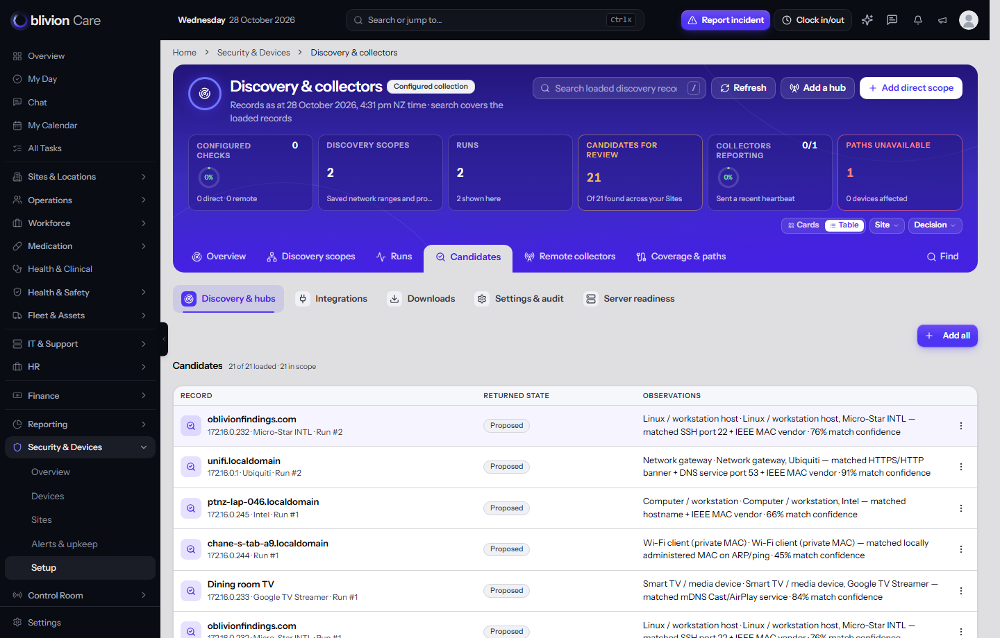
- **Add direct discovery scope — Step 3 (10 plain-English discovery protocols, optional SNMP reference, and rate limits):**
  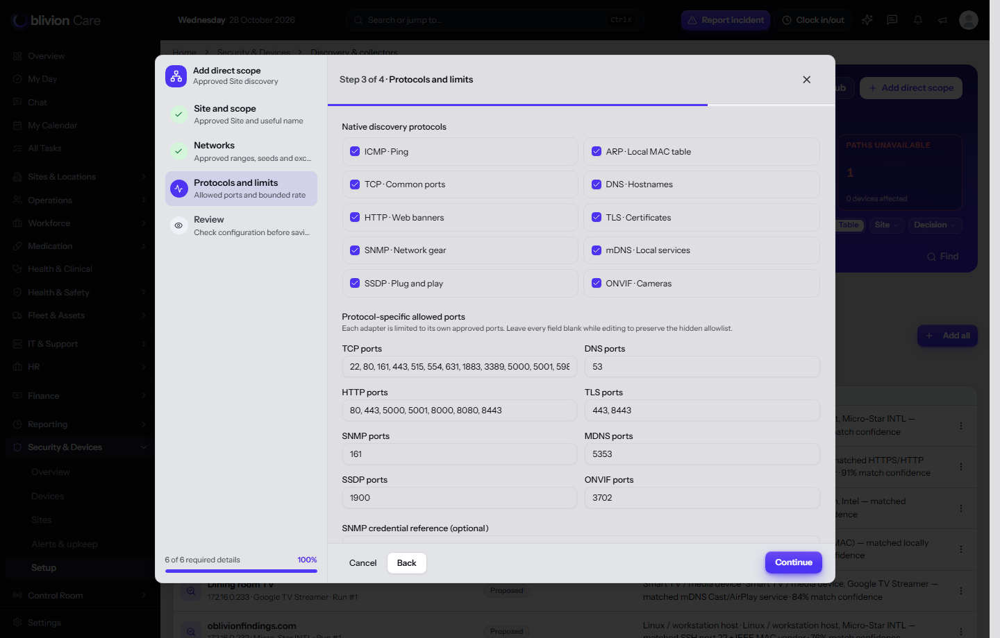
- **Candidate details (`c120.localdomain` — `IP camera`, `TP-Link Tapo C120`, `82%`, MAC `78:20:51:68:A2:84 · TP-Link Systems Inc.`, `Why we think so`):**
  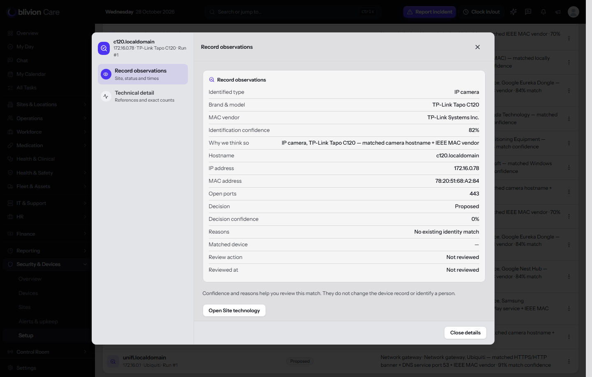
- **Pre-filled `Add as device` dialog (`Security` › `CCTV` › `IP Camera`, `TP-Link` `Tapo C120`, `82% confidence`):**
  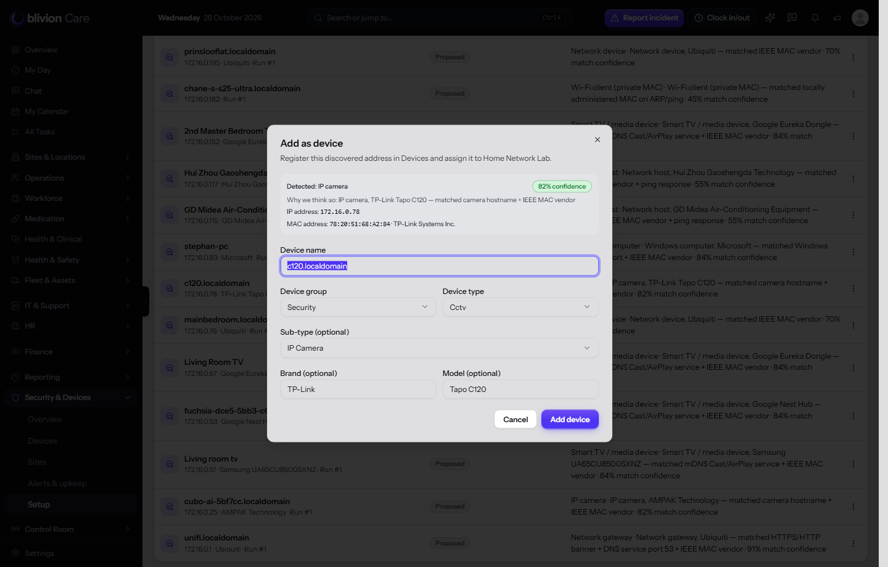
- **All devices after clicking `Add all` (`21` real `172.16.0.0/24` devices adopted with detected domain, category, sub-type, brand, and model):**
  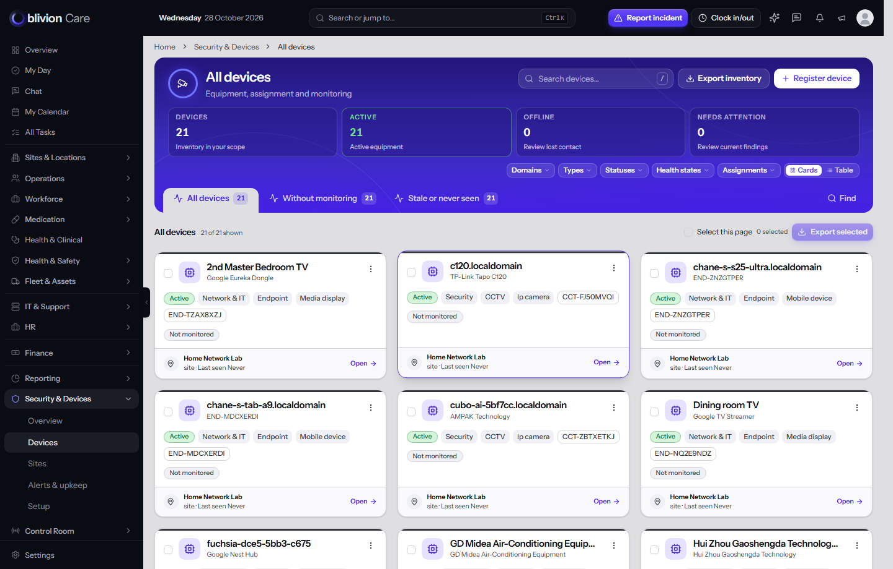

